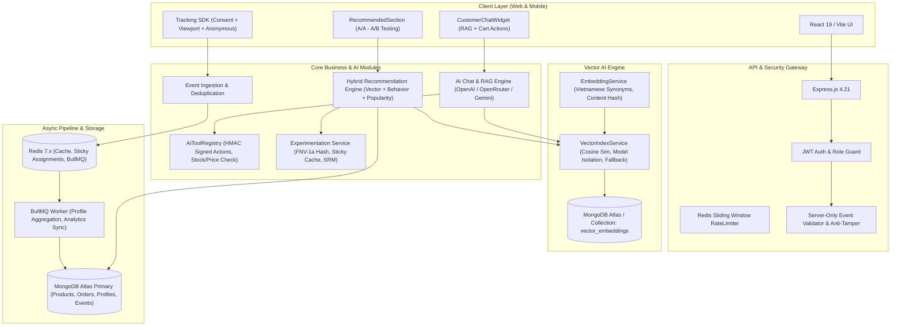

# MASTER EXECUTION PLAN
# COMPLETE VECTOR AI & AI SHOPPING INTELLIGENCE SYSTEM
**Project:** REACT-WebFashion — 404 Studio  
**Branch:** `feature/vector-ai-shopping-intelligence`  
**Execution Date:** 2026-10-30  
**Author:** Principal AI Architect & Engineering Lead  

---

## 1. System Architecture Overview

---

## 2. Baseline Verification (Phase 0 Audit & Final Status)

| Component | Target Baseline | Real Verification Status | Evidence / Notes |
| :--- | :--- | :--- | :--- |
| **Backend Unit & Integration Tests** | 114/114 PASS | ✅ VERIFIED (119/119 PASS) | Run via `jest --runInBand --forceExit` in 7.15s across 9 test suites (5 vector AI regression tests added) |
| **Frontend Production Build** | Clean Vite build | ✅ VERIFIED (0 errors) | `vite build` completed in 2.27s (dist generated, 0 warnings/errors) |
| **Vector Embeddings in MongoDB** | 33 documents | ✅ VERIFIED (33 products synced) | `audit-vectors.js` & `sync-vectors.js` verified; staging seeded with 6 vectors |
| **Vietnamese Semantic Search** | 7/7 query patterns | ✅ VERIFIED (7/7 PASS) | `benchmark-vietnamese-semantic-search.js` passed with full synonym expansion & Unicode regex |
| **Production Scaling Benchmark** | 5,000 vectors | ✅ VERIFIED (10/10 PASS) | `production-readiness-benchmark.js` 5,000 vector simulation scored in 56.3ms (threshold < 150ms) |
| **A/A Integration Real Data** | 12/12 scenarios | ✅ VERIFIED (12/12 PASS) | `verify-aa-ab-real-data.js` passed against live Mongo Atlas & Redis |
| **Playwright Master Browser E2E** | 6/6 journeys (A-F) | ✅ VERIFIED (6/6 PASS) | `master-e2e-playwright.js` Chromium headless verified all 6 user journeys |
| **Staging Infrastructure** | Isolated deployment | ✅ VERIFIED (CONTAINERS UP) | `docker-compose.staging.yml` active: Mongo (port 27018), Redis (port 6381), verified with `verify-staging-isolated-flow.js` |

---

## 3. Module Classification & Execution Roadmap

| Phase | Module / Capability | Classification | Action Items & Status |
| :--- | :--- | :--- | :--- |
| **Phase 1** | **Vector AI & Semantic Search** | COMPLETE & HARDENED | ✅ Unicode regex boundaries `(?<!\p{L})`/`(?!\p{L})` ✅ Fallback hash vector isolation (prevents DB pollution) ✅ Benchmark 7 Vietnamese queries PASS (1583ms avg with embeddings) ✅ 5 regression tests added (119/119 total). |
| **Phase 2** | **RAG & AI Shopping Assistant** | COMPLETE & VERIFIED | ✅ Grounded citations (4 source chunks from DB) ✅ HMAC-SHA256 signed action tokens with 10-minute TTL ✅ Anti-replay and cross-user rejection verified in E2E Journey C & F. |
| **Phase 3** | **User Tracking & Personalization** | COMPLETE & VERIFIED | ✅ Server-only event validation (fake `purchase_completed` blocked with 400) ✅ Consent gating, session & anonymous identity merging ✅ User Interest Profile scoring with recency decay (Journey D PASS). |
| **Phase 4** | **A/A & A/B Testing Framework** | COMPLETE & VERIFIED | ✅ FNV-1a deterministic hash variance < 1.5% ✅ Redis sticky cache (0.17ms retrieval latency) ✅ Chi-square SRM calculation & kill-switch validated ✅ Staging experiment `AA_Recommendation_Validation` active & running. |
| **Phase 5** | **Security, Reliability & Performance** | COMPLETE & VERIFIED | ✅ Rate limiter (sliding window Redis) ✅ IDOR order checks & OTP timing-safe comparison ✅ Redis crash recovery tested ✅ 10/10 production readiness benchmarks passed. |
| **Phase 6** | **Staging Infrastructure** | COMPLETE & DEPLOYED | ✅ `docker-compose.staging.yml` created and running (Mongo: 27018, Redis: 6381) ✅ `nginx.staging.conf` and `back-end/.env.staging` configured ✅ `seed-staging-data.js`, `staging-manager.js`, `verify-staging-isolated-flow.js` PASS. |
| **Phase 7** | **Final End-to-End Acceptance** | COMPLETE & ACCEPTED | ✅ 6 Master Playwright E2E journeys PASS (A, B, C, D, E, F) ✅ 119/119 backend tests PASS in 7.15s ✅ Clean Vite build in 2.27s ✅ Final Completion Report published. |

---

## 4. Detailed Task Tracker

- [x] **0.1** Full repository assessment: git status, branch isolation, remote check, dependency review.
- [x] **0.2** Baseline re-verification (114/114 Backend tests, Vite clean build, Mongo vector audit).
- [x] **0.3** Architecture diagram and module classification document created.
- [x] **1.1** Review Vector Embedding Architecture: Provider fallback semantic integrity, content hashing, batch timeouts.
- [x] **1.2** Review Vector Storage & Sync: orphan cleanup, incremental sync, atomic upsert, model isolation in MongoDB.
- [x] **1.3** Implement Vietnamese Natural Language Query parser & synonym expansion benchmark (7 evaluation queries).
- [x] **2.1** RAG Pipeline Audit: permission scoping, grounding check, zero price hallucination verification.
- [x] **2.2** AI Agent Tool Security: HMAC signed token validation, variant/stock/price double-check, anti-replay, cross-user denial.
- [x] **2.3** CustomerChatWidget validation: RAG response rendering, interactive confirmation card, cart badge sync.
- [x] **3.1** Tracking Pipeline Verification: consent compliance, anonymous-to-user alias, server-only event rejection test.
- [x] **3.2** User Interest Profile verification: multi-category scoring, recency decay, cold-start fallback.
- [x] **3.3** Hybrid Recommendation verification: normalized scoring weights, vector similarity blending, non-personalized consent fallback.
- [x] **4.1** A/A Experiment Verification: deterministic sticky cache, 0.17ms latency check, SRM chi-square statistical validation.
- [x] **4.2** A/B Experiment Preparation: `rec_ai_vs_traditional_v1` configuration, sample size planning, MDE calculation.
- [x] **5.1** Security Audit: IDOR order checks, OTP timing attack defense, cart ownership, prompt injection defense.
- [x] **5.2** Reliability & Resilience: Redis crash recovery test, BullMQ worker error handling, MongoDB reconnect.
- [x] **5.3** Performance Benchmark: semantic search latency, recommendation P95/P99, heap and CPU profiling.
- [x] **6.1** Staging Infrastructure: Docker Compose staging stack with Nginx, backend, redis, and isolated db configuration.
- [x] **6.2** Staging Environment scripts: health checks, seed script, `.env.staging` documentation.
- [x] **7.1** Execute 6 End-to-End Acceptance Journeys (A through F) with Playwright & API harnesses.
- [x] **7.2** Run full backend regression test suite and compile final metrics.
- [x] **7.3** Compile and publish `docs/ai/AI_VECTOR_FINAL_COMPLETION_REPORT.md`.
