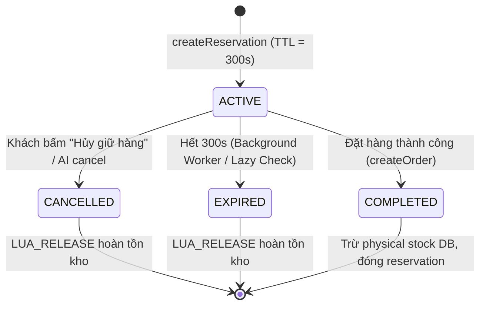

# KIẾN TRÚC GIỮ HÀNG TỒN KHO REDIS (REDIS INVENTORY RESERVATION ARCHITECTURE)
## REACT-WebFashion — 404 Studio

---

## 1. MỤC TIÊU VÀ NGUYÊN TẮC BẮT BUỘC

Trong các hệ thống thương mại điện tử cao cấp và flash sale, xung đột tồn kho (race condition / overselling) là rủi ro nghiêm trọng nhất. Kiến trúc **Redis Inventory Reservation** được thiết kế nhằm đạt các mục tiêu cốt lõi:

1. **Khóa tạm thời chính xác 300 giây (5 phút):** Giữ sản phẩm cho khách hàng trong suốt quá trình điền thông tin và thanh toán. Không tự động gia hạn khi tải lại trang.
2. **Ngăn chặn triệt để bán vượt tồn kho (Zero Overselling Guarantee):** Kiểm tra và khóa số lượng bằng **Lua Script nguyên tử (Atomic Lua Script)** trực tiếp trong Redis engine.
3. **Kiểm tra giỏ hàng toàn phần (All-or-Nothing Multi-Item Check):** Nếu đơn hàng có 3 sản phẩm mà chỉ 2 sản phẩm còn hàng, toàn bộ phiên giữ hàng bị từ chối; không giữ một nửa đơn hàng.
4. **Độ bền dữ liệu hai tầng (Dual-Layer Durability):** Redis quản lý tốc độ và đồng thời (high-concurrency); MongoDB đóng vai trò sổ cái bền vững (durable audit ledger). Khi server khởi động lại (restart/crash), Redis được đồng bộ hóa tức thì từ MongoDB.
5. **Đồng hồ đếm ngược đồng bộ:** Frontend tính toán thời gian thực dựa trên `expiresAt` từ máy chủ, cảnh báo khi còn dưới 60 giây và tự động mở khóa kho khi về 0 giây.

---

## 2. KIẾN TRÚC KHÓA REDIS (REDIS KEY SPACE)

Hệ thống sử dụng không gian khóa có cấu trúc rõ ràng với tiền tố chuẩn:

```
┌────────────────────────────────────────────────────────────────────────┐
│                         REDIS KEY TOPOLOGY                             │
├────────────────────────────────┬─────────────────┬─────────────────────┤
│ Key Name                       │ Redis Type      │ TTL / Purpose       │
├────────────────────────────────┼─────────────────┼─────────────────────┤
│ checkout:reservation:{resId}   │ String (JSON)   │ 300 seconds         │
│                                │                 │ Chi tiết phiên giữ  │
├────────────────────────────────┼─────────────────┼─────────────────────┤
│ stock:reserved:{sku}           │ String (Int)    │ TTL + 3600s         │
│                                │                 │ Tổng SL đang giữ    │
├────────────────────────────────┼─────────────────┼─────────────────────┤
│ stock:reservations:{sku}       │ Set             │ TTL + 3600s         │
│                                │                 │ Danh sách resId giữ │
├────────────────────────────────┼─────────────────┼─────────────────────┤
│ stock:expirations              │ Sorted Set      │ Vĩnh viễn (ZSET)    │
│                                │ (ZSET)          │ Score = expiresAtMs │
└────────────────────────────────┴─────────────────┴─────────────────────┘
```

### Chi tiết các khóa:

1. `checkout:reservation:{reservationId}`:
   - Lưu trữ toàn bộ payload dạng JSON: `reservationId`, `userId`, `items` (sku, productId, variantId, qty, price, name), `status`, `expiresAt`, `totalAmount`.
   - Thiết lập `SETEX` chính xác 300 giây.

2. `stock:reserved:{sku}`:
   - Bộ đếm nguyên tử lưu tổng số lượng sản phẩm/biến thể đang bị khóa tạm thời.
   - SKU được chuẩn hóa: `variant_{id}` đối với biến thể hoặc `product_{id}` đối với sản phẩm đơn lẻ.
   - Số lượng khả dụng tức thời được tính:
     $$\text{Stock}_{\text{khả dụng}} = \max(0, \text{Stock}_{\text{database}} - \text{Stock}_{\text{reserved}})$$

3. `stock:reservations:{sku}`:
   - Tập hợp các `reservationId` đang chiếm giữ SKU này, phục vụ tra cứu ngược và dọn dẹp khi cần.

4. `stock:expirations`:
   - Sorted Set lưu danh sách các `reservationId` với `score` là timestamp hết hạn tính bằng mili-giây (`expiresAtMs`).
   - Giúp Background Reconciler quét nhanh các phiên hết hạn bằng câu lệnh `ZRANGEBYSCORE stock:expirations 0 {nowMs}` với độ phức tạp $O(\log(N) + M)$.

---

## 3. LUA SCRIPTS NGUYÊN TỬ (ATOMIC LUA TRANSACTIONS)

Redis xử lý đơn luồng, đảm bảo rằng mã Lua Script được thực thi hoàn toàn nguyên tử (atomic), không bị gián đoạn hay xen ngang bởi bất kỳ tiến trình nào khác.

### 3.1. Lua Script Đặt chỗ (`LUA_RESERVE`)
Đảm bảo kiểm tra toàn phần (All-or-nothing):
```lua
local resKey = KEYS[1]
local expirationsKey = KEYS[2]
local resId = ARGV[1]
local resJson = ARGV[2]
local expiresAtMs = tonumber(ARGV[3])
local ttlSec = tonumber(ARGV[4])
local numItems = tonumber(ARGV[5])
local baseIdx = 6

-- Bước 1: Kiểm tra khả dụng cho TẤT CẢ sản phẩm trong danh sách
for i = 1, numItems do
  local sku = ARGV[baseIdx + (i - 1) * 3]
  local requested = tonumber(ARGV[baseIdx + (i - 1) * 3 + 1])
  local dbStock = tonumber(ARGV[baseIdx + (i - 1) * 3 + 2])
  local reservedKey = "stock:reserved:" .. sku
  local currentReserved = tonumber(redis.call("GET", reservedKey) or "0")
  local available = dbStock - currentReserved

  if available < requested then
    -- Thất bại ngay lập tức, trả về SKU không đủ hàng và số lượng còn lại
    return {0, sku, tostring(math.max(0, available))}
  end
end

-- Bước 2: Tăng bộ đếm giữ hàng cho toàn bộ sản phẩm (Chỉ chạy khi tất cả đều đủ hàng)
for i = 1, numItems do
  local sku = ARGV[baseIdx + (i - 1) * 3]
  local requested = tonumber(ARGV[baseIdx + (i - 1) * 3 + 1])
  local reservedKey = "stock:reserved:" .. sku
  local reservationsKey = "stock:reservations:" .. sku

  redis.call("INCRBY", reservedKey, requested)
  redis.call("SADD", reservationsKey, resId)
  redis.call("EXPIRE", reservedKey, ttlSec + 3600)
  redis.call("EXPIRE", reservationsKey, ttlSec + 3600)
end

-- Bước 3: Lưu session giữ hàng và ghi vào Sorted Set lịch hết hạn
redis.call("SETEX", resKey, ttlSec, resJson)
redis.call("ZADD", expirationsKey, expiresAtMs, resId)
return {1, "OK"}
```

### 3.2. Lua Script Giải phóng (`LUA_RELEASE`)
Thu hồi số lượng đã khóa khi khách hủy hoặc khi hết 300 giây:
```lua
local resKey = KEYS[1]
local expirationsKey = KEYS[2]
local resId = ARGV[1]
local numItems = tonumber(ARGV[2])
local baseIdx = 3

-- Xóa session và loại khỏi danh sách hết hạn
redis.call("DEL", resKey)
redis.call("ZREM", expirationsKey, resId)

-- Hoàn trả số lượng tồn kho nguyên tử
for i = 1, numItems do
  local sku = ARGV[baseIdx + (i - 1) * 2]
  local qty = tonumber(ARGV[baseIdx + (i - 1) * 2 + 1])
  local reservedKey = "stock:reserved:" .. sku
  local reservationsKey = "stock:reservations:" .. sku

  local current = tonumber(redis.call("GET", reservedKey) or "0")
  local updated = current - qty
  if updated <= 0 then
    redis.call("DEL", reservedKey)
  else
    redis.call("SET", reservedKey, tostring(updated))
  end
  redis.call("SREM", reservationsKey, resId)
end
return {1, "RELEASED"}
```

### 3.3. Lua Script Hoàn tất Đơn hàng (`LUA_COMMIT`)
Được gọi từ `createOrder.command.js` khi khách hàng nhấn đặt hàng:
- Kiểm tra tính hợp lệ của reservation.
- Giảm số lượng `stock:reserved:{sku}` tương ứng (vì lúc này trừ trực tiếp vào DB physical stock của sản phẩm/biến thể).
- Chuyển trạng thái sang `COMPLETED` để chống tái sử dụng.

---

## 4. VÒNG ĐỜI VÀ CƠ CHẾ DỌN DẸP HẾT HẠN (LIFECYCLE & PRUNING)



### Ba tầng xử lý hết hạn:
1. **TTL tự nhiên của Redis:** Khóa `checkout:reservation:{id}` tự biến mất sau 300 giây.
2. **Lazy On-Read Expiration:** Khi frontend hoặc backend gọi `getReservation(id)`, nếu `Date.now() > reservation.expiresAt`, hệ thống tự động đánh dấu `EXPIRED` và kích hoạt giải phóng ngay.
3. **Background Reconciler Worker:**
   - Chạy định kỳ mỗi 10 giây (`setInterval`).
   - Lấy danh sách các session quá hạn từ `stock:expirations`:
     ```javascript
     const expiredIds = await redis.zrangebyscore("stock:expirations", 0, Date.now());
     ```
   - Lặp qua từng ID, cập nhật trạng thái trong MongoDB thành `EXPIRED` và gọi `LUA_RELEASE`.

---

## 5. ĐỘ BỀN VÀ KHẢ NĂNG PHỤC HỒI SAU SỰ CỐ (DURABLE LEDGER & RECOVERY)

### 5.1. Mongoose Model: `InventoryReservation`
Tọa lạc tại `back-end/src/modules/inventory/inventoryReservation.model.js`:
- Trường lưu trữ: `reservationId`, `userId`, `items` (chi tiết productId, variantId, sku, qty, price), `totalAmount`, `status` (`ACTIVE`, `EXPIRED`, `CANCELLED`, `COMPLETED`), `idempotencyKey`, `expiresAt`, `completedAt`, `releaseReason`.
- Chỉ mục tối ưu:
  - `{ reservationId: 1 }` (unique)
  - `{ expiresAt: 1, status: 1 }`
  - `{ idempotencyKey: 1 }` (sparse, unique)

### 5.2. Khôi phục tự động khi khởi động lại (`reconcileReservationsFromDB`)
Được móc trực tiếp vào hàm khởi tạo của `back-end/src/server.js`:
```javascript
await reconcileReservationsFromDB();
```
Quy trình thực hiện:
1. Quét MongoDB tìm tất cả bản ghi có `status: "ACTIVE"`.
2. Đối với các bản ghi đã quá `expiresAt`: Cập nhật trạng thái thành `EXPIRED`, giải phóng Redis nếu còn sót.
3. Đối với các bản ghi còn hiệu lực (`expiresAt > Date.now()`):
   - Tính toán thời gian còn lại: `ttl = Math.ceil((expiresAt - Date.now()) / 1000)`.
   - Tái tạo khóa `checkout:reservation:{id}`, cộng dồn `stock:reserved:{sku}`, và nạp lại vào `stock:expirations`.
4. Đảm bảo ngay cả khi Node.js process hoặc Redis bị khởi động lại đột ngột, toàn bộ số lượng giữ hàng đang hiệu lực không bị thất thoát hay cho phép mua vượt.

---

## 6. TÍCH HỢP TOÀN DIỆN VÀ BẢO VỆ CHỐNG BÁN VƯỢT (END-TO-END INTEGRATION)

### 6.1. Tầng Xem Sản phẩm (`product.query.js`)
Trong hàm `enrichProductWithPricing`:
- Hệ thống truy vấn đồng thời `getReservedStock(sku)` cho từng biến thể và sản phẩm cha.
- Số lượng hiển thị ra giao diện:
  ```javascript
  const reservedQty = await inventoryReservationService.getReservedStock(sku);
  variant.available_stock = Math.max(0, (variant.stock || 0) - reservedQty);
  ```
- Khách hàng duyệt web lập tức thấy số lượng khả dụng thực tế sau khi đã trừ lượng đang bị giữ bởi các phiên checkout khác.

### 6.2. Tầng Giỏ hàng (`cart.service.js`)
Khi thêm hàng vào giỏ (`addCartItem`):
- Hệ thống kiểm tra số lượng yêu cầu so với `available_stock` (đã trừ Redis reserved).
- Nếu tổng số lượng trong giỏ vượt quá lượng khả dụng, API trả về lỗi: *"Sản phẩm chỉ còn lại X cái khả dụng (đang có người giữ hàng thanh toán)"*.

### 6.3. Tầng Checkout (`Checkout/index.jsx`)
- Trang `/checkout?reservationId=...` đọc dữ liệu phiên giữ hàng.
- Đồng hồ đếm ngược hiển thị nổi bật ở đầu trang:
  - Trên 60 giây: Trạng thái bình thường màu xanh ngọc / đen tối giản.
  - Dưới 60 giây: Chuyển màu cảnh báo cam/đỏ, rung nhẹ nhắc nhở khách hoàn tất thanh toán.
  - 0 giây: Nút đặt hàng bị vô hiệu hóa, thông báo phiên giữ hàng đã hết hạn và tự giải phóng kho.
- Nút "Hủy giữ hàng": Cho phép khách chủ động hủy, lập tức trả lại tồn kho cho người khác.

