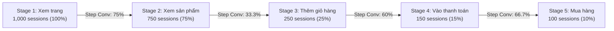

# ANALYTICS & METRICS SPECIFICATION
## Dự án: REACT-WebFashion (404 Studio)
## Môi trường: Production & Staging Hardened

---

## 1. TỔNG QUAN PHƯƠNG PHÁP LUẬN TÍNH TOÁN

Hệ thống phân tích hành vi người dùng (Tracking Analytics) của REACT-WebFashion cung cấp dữ liệu định lượng phục vụ:
1. **Tối ưu hóa phễu chuyển đổi (Conversion Rate Optimization - CRO):** Đo lường sự sụt giảm qua từng bước từ xem trang đến mua hàng.
2. **Đánh giá hiệu quả gợi ý cá nhân hóa (Personalization & AI CTR):** Đo lường mức độ tương tác với thanh đề xuất sản phẩm và trợ lý AI Stylist.
3. **Mô hình tính điểm hồ sơ sở thích (User Interest Profile Scoring):** Tính toán điểm quan tâm suy biến theo thời gian (Exponential Half-life Decay).
4. **Phân tích thống kê thử nghiệm (A/B & A/A Experimentation Statistics):** Kiểm định tính vô tư trong phân nhóm (SRM Chi-Square), tỷ lệ chuyển đổi và độ tăng trưởng tương đối (Relative Uplift).

---

## 2. PHỄU CHUYỂN ĐỔI MUA HÀNG (CONVERSION FUNNEL ANALYTICS)

### 2.1. Định nghĩa 5 giai đoạn trong phễu mua hàng

Phễu chuyển đổi e-commerce được chuẩn hóa thành 5 giai đoạn liên tiếp:

| Giai đoạn | Mã giai đoạn | Tên hiển thị | Các sự kiện cấu thành |
| :---: | :--- | :--- | :--- |
| **Stage 1** | `page_view` | Xem trang | `page_view` |
| **Stage 2** | `product_view` | Xem sản phẩm | `product_view`, `view_product`, `product_click` |
| **Stage 3** | `add_to_cart` | Thêm vào giỏ | `add_to_cart` |
| **Stage 4** | `checkout_started` | Bắt đầu thanh toán | `checkout_started`, `checkout_start` |
| **Stage 5** | `purchase_completed` | Hoàn tất đơn hàng | `purchase_completed`, `purchase`, `purchase_done`, `order_placed` |

---

### 2.2. Vấn đề bất thường dữ liệu (Conversion Anomaly) & Giải pháp Cohort Đồng nhất

#### Vấn đề:
Nếu tính tỷ lệ chuyển đổi bằng cách lấy tổng số sự kiện thô:
$$\text{Tỷ lệ sai lệch} = \frac{\text{Count}(\text{Event}_{i})}{\text{Count}(\text{Event}_{i-1})}$$
Người dùng thường xem nhiều sản phẩm hoặc thêm nhiều món hàng trong một phiên, dẫn đến hiện tượng số lượng `product_view` hoặc `add_to_cart` vượt quá số lượng `page_view`, tạo ra tỷ lệ chuyển đổi $> 100\%$ phi lý.

#### Giải pháp chuẩn hóa (Unified Cohort Normalization):
Backend `tracking.service.js` cố định mẫu số đồng nhất theo phiên (`uniqueSessions`) hoặc người dùng duy nhất (`uniqueUsers`):

#### Công thức tính toán chính thức:

1. **Tỷ lệ chuyển đổi tổng thể (Overall Conversion Rate):**
   $$\text{Overall Rate}_i = \begin{cases} 100\%, & \text{khi } i = 1 \\ \dfrac{N_i}{N_{\text{base\_cohort}}} \times 100\%, & \text{khi } i > 1 \end{cases}$$
   *Trong đó $N_i$ là số `uniqueSessions` hoặc `uniqueUsers` đạt giai đoạn $i$, $N_{\text{base\_cohort}} = N_1$.*

2. **Tỷ lệ chuyển đổi theo bước (Step-by-Step Conversion Rate):**
   $$\text{Step Rate}_i = \begin{cases} 100\%, & \text{khi } i = 1 \\ \dfrac{N_i}{N_{i-1}} \times 100\%, & \text{khi } i > 1 \text{ và } N_{i-1} > 0 \\ 0\%, & \text{khi } N_{i-1} = 0 \end{cases}$$

3. **Tỷ lệ rời bỏ (Drop-off Rate):**
   $$\text{Drop-off Rate}_i = 100\% - \text{Step Rate}_i$$

---

## 3. CHỈ SỐ ĐO LƯỜNG HIỆU QUẢ GỢI Ý (RECOMMENDATION & AI METRICS)

### 3.1. Click-Through Rate của Khối Gợi Ý (Shelf Recommendation CTR)

Đo lường tỷ lệ người dùng nhấp vào sản phẩm được gợi ý trên tổng số lần nhìn thấy sản phẩm gợi ý:

$$\text{CTR}_{\text{Rec}} = \frac{\text{Count}(\text{recommendation\_clicked}) + \text{Count}(\text{product\_click})}{\text{Count}(\text{recommendation\_impression}) + \text{Count}(\text{product\_impression})} \times 100\%$$

*Giá trị benchmark mục tiêu trong thương mại điện tử thời trang: $3.5\% - 7.0\%$.*

---

### 3.2. Click-Through Rate của Trợ Lý AI Chatbot (AI Stylist CTR)

Đo lường mức độ tương tác với các sản phẩm do mô hình Vector AI / Semantic Search đề xuất trong khung chat:

$$\text{CTR}_{\text{AI}} = \frac{\text{Count}(\text{ai\_recommendation\_clicked})}{\text{Count}(\text{ai\_product\_recommended})} \times 100\%$$

*Giá trị benchmark mục tiêu: $10.0\% - 20.0\%$ (Intent của người dùng trò chuyện thường cao hơn duyệt thông thường).*

---

### 3.3. Tỷ lệ xác nhận hành động AI (AI Cart Action Confirmation Rate)

Tỷ lệ người dùng chấp nhận cho AI thêm sản phẩm vào giỏ hàng tự động sau khi được tư vấn:

$$\text{Rate}_{\text{AI\_Cart}} = \frac{\text{Count}(\text{ai\_cart\_action\_confirmed})}{\text{Count}(\text{ai\_chat\_opened})} \times 100\%$$

---

### 3.4. Mô hình ghi nhận đơn hàng cho Gợi ý (24-Hour Recommendation Attribution)

Hệ thống áp dụng mô hình **Last-Touch Attribution có cửa sổ quan sát 24 giờ (Lookback Window = 86,400 giây)**:
1. Khi người dùng nhấp vào một sản phẩm từ Recommendation hoặc AI Chat, Redis lưu trữ key:
   - Key: `tracking:attr:click:<user_id|anonymous_id>:<product_id>`
   - TTL: 86,400 giây (24 giờ).
2. Khi Backend ghi nhận sự kiện `purchase_completed`:
   - Kiểm tra xem bất kỳ sản phẩm nào trong đơn hàng có khớp với key trong Redis không.
   - Nếu có ít nhất 1 sản phẩm khớp:
     - Gắn cờ `attributed_recommendation = true`.
     - Doanh thu từ sản phẩm đó được phân bổ vào `Attributed Recommendation Revenue`.

$$\text{Doanh thu gợi ý} = \sum_{\text{order} \in \text{Orders}} \sum_{\text{item} \in \text{order.items}} (\text{item.price} \times \text{item.quantity}) \cdot \mathbb{I}(\text{item is attributed})$$

---

## 4. MÔ HÌNH HỒ SƠ SỞ THÍCH & HỆ SỐ SUY BIẾN THỜI GIAN (HALF-LIFE DECAY)

### 4.1. Công thức phân rã hàm mũ (Exponential Decay Formula)

Sở thích của khách hàng về phong cách, màu sắc và danh mục sản phẩm giảm dần theo thời gian nếu không được kích hoạt lại. Hệ thống sử dụng chu kỳ bán rã **$T_{\text{half}} = 14$ ngày**:

$$S(t) = W_e \cdot e^{-\lambda \cdot \Delta t} = W_e \cdot \left(\frac{1}{2}\right)^{\frac{\Delta t}{14}}$$

Trong đó:
- $W_e$: Trọng số gốc của hành vi (Behavioral Weight từ `tracking.constants.js`).
- $\Delta t$: Số ngày trôi qua kể từ thời điểm sự kiện phát sinh: $\Delta t = \frac{t_{\text{hiện tại}} - t_{\text{sự kiện}}}{86,400,000\text{ ms}}$.
- $\lambda$: Hằng số phân rã: $\lambda = \frac{\ln(2)}{14} \approx 0.04951$.

### 4.2. Bảng đối chiếu hệ số suy giảm theo thời gian

| Thời gian trôi qua ($\Delta t$) | Hệ số giữ lại $\left(\frac{1}{2}\right)^{\Delta t / 14}$ | Trọng số thực tế của Mua hàng ($W=5$) | Trọng số thực tế của Thêm giỏ ($W=3$) |
| :---: | :---: | :---: | :---: |
| **0 ngày (Hôm nay)** | $1.000$ ($100\%$) | $5.00$ | $3.00$ |
| **7 ngày** | $0.707$ ($70.7\%$) | $3.54$ | $2.12$ |
| **14 ngày (1 chu kỳ)** | $0.500$ ($50.0\%$) | $2.50$ | $1.50$ |
| **28 ngày (2 chu kỳ)** | $0.250$ ($25.0\%$) | $1.25$ | $0.75$ |
| **56 ngày (4 chu kỳ)** | $0.0625$ ($6.25\%$) | $0.31$ | $0.19$ |

### 4.3. Cập nhật hồ sơ sở thích đa chiều (Multi-dimensional Profile)
- **Category Affinities:** Cập nhật điểm danh mục tương ứng. Giới hạn lưu trữ Top 15 danh mục có điểm cao nhất.
- **Search Keywords:** Cập nhật trọng số từ khóa tìm kiếm. Tối đa 50 từ khóa gần nhất.
- **Recent Product IDs:** Danh sách trượt (sliding window) lưu trữ tối đa 20 sản phẩm tương tác gần nhất để tránh trùng lặp gợi ý (Dedup filter trong Recommendation Engine).

---

## 5. THỐNG KÊ THỬ NGHIỆM A/B & KIỂM ĐỊNH TÍNH VÔ TƯ (A/B TESTING & SRM)

### 5.1. Kiểm định chênh lệch tỷ lệ mẫu (Sample Ratio Mismatch - SRM)

Kiểm định SRM sử dụng thống kê **Chi-Square Goodness-of-Fit** ($\chi^2$) với bậc tự do $df = K - 1 = 1$:

$$\chi^2 = \sum_{k \in \{A, B\}} \frac{(O_k - E_k)^2}{E_k}$$

Trong đó:
- $O_k$: Số lượng quan sát thực tế được phân bổ vào nhóm $k$.
- $E_k$: Số lượng kỳ vọng theo tỷ lệ phân bổ ($p_k \cdot N_{\text{total}}$). Đối với tỷ lệ $50\% - 50\%$: $E_A = E_B = \frac{O_A + O_B}{2}$.

#### Tiêu chí đánh giá tính hợp lệ của thử nghiệm:
- **Ngưỡng ý nghĩa:** $\alpha = 0.01$ (hoặc $p$-value $< 0.001$ trong hệ thống giám sát tự động).
- Với $df = 1$ và $\alpha = 0.01$, giá trị tới hạn $\chi^2_{\text{critical}} = 6.635$.
  - Nếu $\chi^2 \le 6.635$ ($p \ge 0.01$): **PASSED — Không có thiên lệch mẫu (No SRM detected)**. Dữ liệu thử nghiệm hoàn toàn đáng tin cậy.
  - Nếu $\chi^2 > 6.635$ ($p < 0.01$): **FAILED — Cảnh báo thiên lệch mẫu (SRM Alert)**. Kích hoạt cảnh báo trên Dashboard và khuyến nghị tạm dừng thử nghiệm.

---

### 5.2. Tỷ lệ chuyển đổi và Mức tăng trưởng tương đối (Relative Uplift)

- **Tỷ lệ chuyển đổi của nhóm $k$:**
  $$\text{CR}_k = \frac{\text{Conversions}_k}{N_k} \times 100\%$$
- **Mức tăng trưởng tương đối (Relative Uplift của Treatment so với Control):**
  $$\text{Relative Uplift} = \frac{\text{CR}_B - \text{CR}_A}{\text{CR}_A} \times 100\%$$

### 5.3. Khoảng tin cậy 95% (95% Confidence Interval) & Z-Test

Khoảng tin cậy 95% cho sự chênh lệch tỷ lệ $p_B - p_A$:
$$CI_{95\%} = (p_B - p_A) \pm 1.96 \cdot \sqrt{\frac{p_A(1 - p_A)}{N_A} + \frac{p_B(1 - p_B)}{N_B}}$$

Khi $0 \notin CI_{95\%}$, sự khác biệt giữa hai nhóm đạt ý nghĩa thống kê (Statistically Significant) ở độ tin cậy $95\%$.
