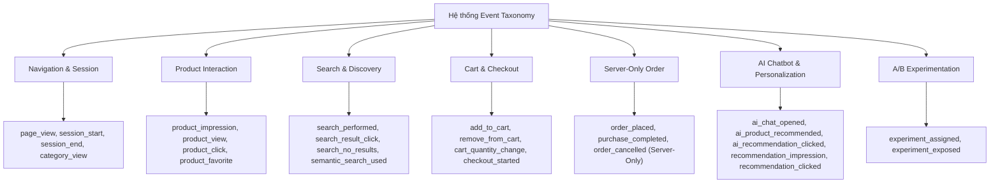

# EVENT TAXONOMY & DATA CONTRACT SPECIFICATION
## Dự án: REACT-WebFashion (404 Studio)
## Môi trường: Production & Staging Hardened

---

## 1. TỔNG QUAN KIẾN TRÚC TAXONOMY

Hệ thống User Behavior Tracking của REACT-WebFashion áp dụng chuẩn Data Contract thống nhất giữa Client (Web Browser) và Backend (Ingestion API & BullMQ Worker). Hợp đồng dữ liệu đảm bảo:
1. **Tính tương thích ngược (Backward Compatibility):** Tiếp nhận cả canonical naming (`event_type`, `timestamp`, `checkout_started`, `purchase_completed`) lẫn legacy aliases (`event_name`, `created_at`, `createdAt`, `checkout_start`, `purchase_done`, `purchase`, `search`, `favorite`, `view_product`).
2. **Bảo mật phân quyền nguồn phát (Source Guard):** Ngăn chặn tuyệt đối việc client mạo danh các sự kiện tài chính/đơn hàng (`purchase_completed`, `order_placed`, `order_cancelled`).
3. **Chuẩn hóa Identity & Session:** Mọi sự kiện đều gắn liền với bộ ba định danh `user_id` (nếu đã đăng nhập), `anonymous_id` (UUIDv4) và `session_id` (30-phút sliding inactivity window).
4. **Bảo vệ quyền riêng tư (Privacy & PII Sanitization):** Tự động phát hiện và che giấu thông tin cá nhân (Email, Số điện thoại) trong các trường chuỗi tìm kiếm (`query`) và metadata.

---

## 2. PHÂN LỚP DANH MỤC SỰ KIỆN (EVENT CATEGORIES)



---

## 3. CHI TIẾT CÁC SỰ KIỆN & PAYLOAD SCHEMA

### 3.1. Navigation & Session Events

#### `page_view`
- **Mục đích:** Ghi nhận lượt xem trang của người dùng.
- **Nguồn phát:** Client (`usePageTracking` hook khi route thay đổi).
- **Trọng số điểm ($W_e$):** `0.05`
- **Payload Schema:**
```json
{
  "event_type": "page_view",
  "anonymous_id": "9b1deb4d-3b7d-4bad-9bdd-2b0d7b3dcb6d",
  "session_id": "sess_1730301234567_abc123",
  "timestamp": "2026-10-31T00:15:00.000Z",
  "context": {
    "pathname": "/shop",
    "referrer": "https://google.com",
    "deviceType": "desktop"
  }
}
```

#### `session_start` / `session_end`
- **Mục đích:** Đánh dấu bắt đầu phiên mới (khi người dùng mở trang sau 30 phút không hoạt động) hoặc kết thúc phiên (khi tab đóng / session hết hạn).
- **Nguồn phát:** Client (`session.service.js`).
- **Trọng số điểm ($W_e$):** `0`

#### `category_view`
- **Mục đích:** Ghi nhận khi người dùng duyệt danh mục sản phẩm (ví dụ: Áo Nam, Váy Nữ).
- **Trọng số điểm ($W_e$):** `0.5`
- **Payload Schema:**
```json
{
  "event_type": "category_view",
  "category_id": "6720f123456789abcdef0001",
  "meta": {
    "category_name": "Thời Trang Nam",
    "slug": "thoi-trang-nam"
  }
}
```

---

### 3.2. Product Interaction Events

#### `product_impression`
- **Mục đích:** Ghi nhận sản phẩm hiển thị trong viewport người dùng với ngưỡng tối thiểu $\ge 50\%$ diện tích và dwell time $\ge 500\text{ms}$.
- **Cơ chế chống spam:** IntersectionObserver + Dwell Time debounce + Redis Deduplication (5 phút theo `sess:prod:dwell`).
- **Trọng số điểm ($W_e$):** `0.05`
- **Payload Schema:**
```json
{
  "event_type": "product_impression",
  "product_id": "6720f999999999abcdef0101",
  "category_id": "6720f123456789abcdef0001",
  "meta": {
    "position": 1,
    "list_type": "homepage_featured",
    "dwell_time_ms": 650
  }
}
```

#### `product_view` (Legacy: `view_product`)
- **Mục đích:** Xem chi tiết sản phẩm trên trang `/product/:id`.
- **Trọng số điểm ($W_e$):** `1.0`
- **Payload Schema:**
```json
{
  "event_type": "product_view",
  "product_id": "6720f999999999abcdef0101",
  "category_id": "6720f123456789abcdef0001",
  "meta": {
    "product_name": "Áo Sơ Mi Oxford Slimfit",
    "price": 450000,
    "brand": "404 Studio",
    "source": "organic_catalog"
  }
}
```

#### `product_click`
- **Mục đích:** Nhấp chuột vào thẻ sản phẩm từ danh sách sản phẩm hoặc banner.
- **Trọng số điểm ($W_e$):** `0.8`

#### `product_favorite` / `product_unfavorite` (Legacy: `favorite`)
- **Mục đích:** Thêm hoặc bỏ sản phẩm khỏi danh sách yêu thích.
- **Trọng số điểm ($W_e$):** `+3.0` (Favorite), `-1.0` (Unfavorite).

---

### 3.3. Search & Discovery Events

#### `search_performed` (Legacy: `search`)
- **Mục đích:** Thực hiện tìm kiếm từ khóa trên thanh tìm kiếm hoặc trang tìm kiếm.
- **Bảo mật:** Tự động loại bỏ thông tin PII (Email, Phone) trước khi lưu vào MongoDB.
- **Trọng số điểm ($W_e$):** `1.0`
- **Payload Schema:**
```json
{
  "event_type": "search_performed",
  "query": "áo sơ mi trắng",
  "meta": {
    "results_count": 24,
    "filter_category": "ao-so-mi",
    "filter_price_max": 500000
  }
}
```

#### `search_result_click`
- **Mục đích:** Nhấp chuột vào một sản phẩm cụ thể từ kết quả tìm kiếm. Cho phép đo lường Search CTR và Relevance.
- **Trọng số điểm ($W_e$):** `1.0`
- **Payload Schema:**
```json
{
  "event_type": "search_result_click",
  "product_id": "6720f999999999abcdef0101",
  "query": "áo sơ mi trắng",
  "meta": {
    "position": 2,
    "search_session_id": "srch_1730301999"
  }
}
```

#### `semantic_search_used`
- **Mục đích:** Người dùng kích hoạt tìm kiếm Vector AI / Semantic Search bằng ngôn ngữ tự nhiên.
- **Trọng số điểm ($W_e$):** `1.2`

#### `search_no_results`
- **Mục đích:** Tìm kiếm không trả về kết quả nào (Zero-result search). Dùng để phân tích khoảng trống tồn kho (catalog gaps).
- **Trọng số điểm ($W_e$):** `0.1`

---

### 3.4. Cart & Checkout Events

#### `add_to_cart`
- **Mục đích:** Người dùng thêm sản phẩm vào giỏ hàng (từ trang chi tiết, giỏ hàng nhanh, hoặc qua AI Chatbot).
- **Trọng số điểm ($W_e$):** `3.0`
- **Payload Schema:**
```json
{
  "event_type": "add_to_cart",
  "product_id": "6720f999999999abcdef0101",
  "category_id": "6720f123456789abcdef0001",
  "meta": {
    "quantity": 1,
    "price": 450000,
    "size": "L",
    "color": "Trắng",
    "source": "product_detail"
  }
}
```

#### `remove_from_cart`
- **Mục đích:** Xóa sản phẩm khỏi giỏ hàng.
- **Trọng số điểm ($W_e$):** `-0.5` (Giảm điểm sở thích tương ứng).

#### `checkout_started` (Legacy: `checkout_start`)
- **Mục đích:** Bắt đầu quy trình thanh toán (vào trang `/checkout`).
- **Trọng số điểm ($W_e$):** `2.5`
- **Payload Schema:**
```json
{
  "event_type": "checkout_started",
  "meta": {
    "item_count": 2,
    "cart_total": 850000
  }
}
```

---

### 3.5. Server-Only Order Events (Client Bị Chặn)

> [!CAUTION]
> Các sự kiện sau **BẮT BUỘC PHẢI DO BACKEND TẠO RA** trong quá trình xử lý đơn hàng (`order.controller.js` hoặc thanh toán VNPay/COD). Bất kỳ request nào từ Client gửi kèm các event này đều bị Zod Schema chặn với lỗi `400 Bad Request`.

#### `order_placed`
- **Mục đích:** Đơn hàng được tạo thành công trên hệ thống cơ sở dữ liệu.
- **Nguồn phát:** Backend `order.controller.js` (`createOrder`).
- **Trọng số điểm ($W_e$):** `4.0`

#### `purchase_completed` (Legacy: `purchase`, `purchase_done`)
- **Mục đích:** Khách hàng thanh toán hoàn tất đơn hàng (hoặc xác nhận đơn COD thành công). Kích hoạt cơ chế **Order Attribution Window 24h** để ghi nhận doanh thu cho hệ thống Recommendation.
- **Nguồn phát:** Backend `order.controller.js` hoặc VNPay Webhook IPN.
- **Trọng số điểm ($W_e$):** `5.0`
- **Server Internal Payload:**
```json
{
  "event_type": "purchase_completed",
  "user_id": "6720f555555555abcdef0099",
  "session_id": "sess_1730301234567_abc123",
  "source": "server_order_service",
  "meta": {
    "order_id": "6720f777777777abcdef0333",
    "total_amount": 850000,
    "payment_method": "cod",
    "item_count": 2,
    "attributed_recommendation": true,
    "experiment_id": "AA_Recommendation_Validation",
    "variant_id": "control_popular"
  }
}
```

#### `order_cancelled`
- **Mục đích:** Đơn hàng bị hủy.
- **Trọng số điểm ($W_e$):** `-2.0`

---

### 3.6. AI & Recommendation Events

#### `recommendation_impression` / `recommendation_clicked`
- **Mục đích:** Ghi nhận hiển thị và nhấp chuột vào danh sách sản phẩm gợi ý cá nhân hóa (khối `RecommendedSection`).
- **Trọng số điểm ($W_e$):** `0.1` (Impression), `1.5` (Clicked).
- **Payload Schema:**
```json
{
  "event_type": "recommendation_clicked",
  "product_id": "6720f999999999abcdef0101",
  "meta": {
    "algorithm": "hybrid_vector_collaborative",
    "position": 2,
    "section": "home_personalized_shelf",
    "experiment_id": "AA_Recommendation_Validation",
    "variant_id": "treatment_hybrid_ai"
  }
}
```

#### `ai_chat_opened`
- **Mục đích:** Người dùng mở cửa sổ chat trợ lý AI Fashion Stylist.
- **Trọng số điểm ($W_e$):** `0.2`

#### `ai_product_recommended`
- **Mục đích:** AI Chatbot gợi ý danh sách sản phẩm trực tiếp trong khung trò chuyện qua Tool Calling (`search_catalog`).
- **Trọng số điểm ($W_e$):** `0.1`

#### `ai_recommendation_clicked`
- **Mục đích:** Người dùng nhấp vào thẻ sản phẩm do AI gợi ý trong hội thoại.
- **Trọng số điểm ($W_e$):** `2.0`

#### `ai_cart_action_confirmed`
- **Mục đích:** Người dùng phê duyệt hành động AI tự động thêm sản phẩm vào giỏ hàng (`add_to_cart_tool`).
- **Trọng số điểm ($W_e$):** `3.0`

---

### 3.7. A/B Experimentation Events

#### `experiment_assigned`
- **Mục đích:** Deterministic phân nhóm người dùng vào variant A hoặc B (Deterministic CRC32 hash).
- **Trọng số điểm ($W_e$):** `0`

#### `experiment_exposed`
- **Mục đích:** Người dùng thực sự nhìn thấy giao diện/thuật toán của variant được phân bổ trong viewport.
- **Trọng số điểm ($W_e$):** `0.05`

---

## 4. MA TRẬN PHÂN QUYỀN VÀ BẢO MẬT (SOURCE PERMISSION MATRIX)

| Event Type | Client Ingestion (`/api/events/track`) | Server-Only (`createEventInternal`) | Trọng số ($W_e$) | Rate Limit Check |
| :--- | :---: | :---: | :---: | :---: |
| `page_view` | Có | Có | `+0.05` | Có |
| `session_start` / `session_end` | Có | Có | `0` | Có |
| `category_view` | Có | Có | `+0.5` | Có |
| `product_impression` | Có | Có | `+0.05` | Có (Debounce) |
| `product_view` / `view_product` | Có | Có | `+1.0` | Có (5m dedup) |
| `product_click` | Có | Có | `+0.8` | Có |
| `product_favorite` / `favorite` | Có | Có | `+3.0` | Có |
| `product_unfavorite` | Có | Có | `-1.0` | Có |
| `search_performed` / `search` | Có | Có | `+1.0` | Có (PII scrub) |
| `search_result_click` | Có | Có | `+1.0` | Có |
| `semantic_search_used` | Có | Có | `+1.2` | Có |
| `add_to_cart` | Có | Có | `+3.0` | Có |
| `remove_from_cart` | Có | Có | `-0.5` | Có |
| `checkout_started` / `checkout_start` | Có | Có | `+2.5` | Có |
| `recommendation_impression` | Có | Có | `+0.1` | Có |
| `recommendation_clicked` | Có | Có | `+1.5` | Có |
| `ai_chat_opened` | Có | Có | `+0.2` | Có |
| `ai_recommendation_clicked` | Có | Có | `+2.0` | Có |
| `ai_cart_action_confirmed` | Có | Có | `+3.0` | Có |
| `order_placed` | **BỊ CHẶN (400)** | Có | `+4.0` | N/A |
| `purchase_completed` / `purchase` | **BỊ CHẶN (400)** | Có | `+5.0` | N/A |
| `order_cancelled` | **BỊ CHẶN (400)** | Có | `-2.0` | N/A |

---

## 5. BẢNG MÃ ÁNH XẠ TƯƠNG THÍCH NGƯỢC (ALIAS MAPPING)

Hệ thống xử lý tự động tại tầng Ingestion Validator & Normalizer:
```javascript
const EVENT_ALIAS_MAP = {
  view_product: "product_view",
  favorite: "product_favorite",
  search: "search_performed",
  checkout_start: "checkout_started",
  purchase: "purchase_completed",
  purchase_done: "purchase_completed"
};

const TIMESTAMP_ALIAS_MAP = (input) => input.timestamp || input.created_at || input.createdAt || new Date();
const EVENT_TYPE_ALIAS_MAP = (input) => EVENT_ALIAS_MAP[input.event_type || input.event_name] || (input.event_type || input.event_name);
```

---

## 6. QUY TẮC LÀM SẠCH DỮ LIỆU CÁ NHÂN (PII SANITIZATION)

Để đảm bảo tuân thủ tiêu chuẩn an toàn dữ liệu, trường `query` và các giá trị trong `meta` được xử lý qua bộ lọc biểu thức chính quy:
1. **Email Sanitization:**
   - Pattern: `/[a-zA-Z0-9._%+-]+@[a-zA-Z0-9.-]+\.[a-zA-Z]{2,}/gi`
   - Thay thế bằng: `[REDACTED_EMAIL]`
2. **Số điện thoại (Vietnam standard):**
   - Pattern: `/(0|\+84)[3|5|7|8|9][0-9]{8}\b/g`
   - Thay thế bằng: `[REDACTED_PHONE]`

Dữ liệu đã qua làm sạch đảm bảo không lưu thông tin nhận dạng nhạy cảm vào `UserEvent` hay `UserInterestProfile`.
