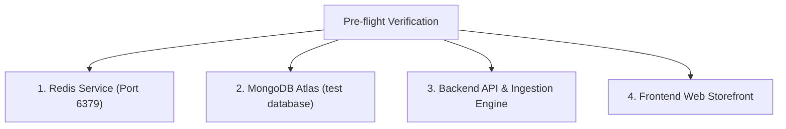

# STAGING & PRODUCTION OPERATIONAL RUNBOOK
## Dự án: REACT-WebFashion (404 Studio)
## Môi trường: Staging & Production Operations Guide

---

## 1. MỤC TIÊU VÀ PHẠM VI ÁP DỤNG

Tài liệu này cung cấp hướng dẫn vận hành chi tiết từng bước (Step-by-step Standard Operating Procedures - SOP) dành cho Tech Lead, DevOps/SRE và QA Engineers để:
1. Khởi động, kiểm tra và duy trì các dịch vụ Tracking, BullMQ Worker, Redis và MongoDB Atlas.
2. Quản lý vòng đời của các thử nghiệm A/B & A/A Testing (`AA_Recommendation_Validation`).
3. Vận hành cơ chế xử lý sự cố khẩn cấp (Emergency Rollback) trong thời gian $< 100\text{ms}$.
4. Xử lý sự cố thường gặp (Incident Response & Troubleshooting).

---

## 2. DANH MỤC KIỂM TRA MÔI TRƯỜNG (PRE-FLIGHT CHECKLIST)

Trước khi kích hoạt hệ thống trên môi trường Staging, thực hiện kiểm tra 4 thành phần bắt buộc:



### Lệnh kiểm tra tài nguyên cách ly an toàn:
```powershell
node back-end/src/scripts/verify-resources.js
```
**Tiêu chí đạt chuẩn:**
- MongoDB State: `1` (Connected). Tên Database: `test` (chứa 30 collections dự án).
- Redis Response: `PONG`. Chỉ chứa các tiền tố: `bull:*`, `exp:*`, `tracking:*`, `sess:*`, `at:*`, `rt:*`.
- Không có bất kỳ truy cập ngoài phạm vi thư mục dự án `D:\Project\REACT-WebFashion`.

---

## 3. QUY TRÌNH KHỞI ĐỘNG VÀ DỪNG DỊCH VỤ (SERVICE MANAGEMENT)

### 3.1. Khởi động Backend API & BullMQ Worker
```powershell
# Chạy ở chế độ Development / Staging
node back-end/src/server.js
```
- Port mặc định: `5000`
- Worker BullMQ tự động khởi chạy kèm theo server với concurrency = 5.
- Log khởi động chuẩn:
  ```text
  info: Connected to MongoDB Database: test
  info: Redis connected successfully on port 6379
  info: BullMQ Tracking Queue initialized [concurrency: 5]
  info: Server running on port 5000
  ```

### 3.2. Khởi động Frontend Storefront
```powershell
# Đóng gói và chạy Preview
npm run build --prefix front-end
npm run preview --prefix front-end -- --port 5173
```
- Endpoint truy cập Storefront: `http://localhost:5173`
- Endpoint truy cập Admin Dashboard: `http://localhost:5173/admin/dashboard`

### 3.3. Dừng dịch vụ an toàn (Graceful Shutdown)
Khi dừng Backend server (Ctrl+C hoặc tín hiệu `SIGTERM`/`SIGINT`):
1. Express ngừng tiếp nhận request mới.
2. BullMQ Worker hoàn tất các job đang xử lý dở dang (Grace period 5,000ms).
3. Đóng kết nối Redis client.
4. Đóng kết nối Mongoose / MongoDB Atlas.

---

## 4. VẬN HÀNH HÀNG ĐỢI BULLMQ & BỘ NHỚ ĐỆM REDIS

### 4.1. Giám sát trạng thái hàng đợi BullMQ
Để kiểm tra số lượng job đang chờ, đang chạy hoặc thất bại:
```javascript
import { trackingQueue } from "../modules/tracking/tracking.service.js";

const counts = await trackingQueue.getJobCounts("active", "waiting", "completed", "failed", "delayed");
console.log("BullMQ Status:", counts);
```

### 4.2. Xử lý khi hàng đợi bị tồn đọng (Queue Backlog Mitigation)
Nếu số lượng `waiting` jobs tăng đột biến ($> 1,000$ jobs):
1. **Tăng tạm thời Concurrency của Worker:**
   Cập nhật biến môi trường `TRACKING_WORKER_CONCURRENCY=10` trong `.env` và restart server.
2. **Kiểm tra độ trễ ghi MongoDB Atlas:**
   Xác minh các chỉ mục (Indexes) trên collection `userevents` hoạt động bình thường:
   - `{ event_type: 1, createdAt: -1 }`
   - `{ user_id: 1, createdAt: -1 }`
   - `{ session_id: 1, createdAt: -1 }`
   - `{ "meta.order_id": 1 }`

---

## 5. QUY TRÌNH QUẢN LÝ THỬ NGHIỆM (EXPERIMENT LIFECYCLE MANAGEMENT)

### 5.1. Khởi tạo Thử nghiệm A/A Testing trên Staging
Thực thi script khởi tạo cấu hình chuẩn:
```powershell
node back-end/src/scripts/setup-staging-aa-experiment.js
```
- **Tên thử nghiệm:** `AA_Recommendation_Validation`
- **Biến thể A:** `control_popular` (Tỷ lệ 50%, thuật toán truyền thống)
- **Biến thể B:** `control_popular` (Tỷ lệ 50%, thuật toán truyền thống - bắt buộc giống nhóm A cho A/A Testing)
- **Trạng thái ban đầu:** `draft`

### 5.2. Chuyển trạng thái sang Đang chạy (Activate Experiment)
Qua giao diện **Admin $\to$ Thử nghiệm A/B** (`/admin/dashboard`), nhấn **"Bắt đầu thử nghiệm"** hoặc gọi API:
```http
POST /api/experiments/AA_Recommendation_Validation/start
Authorization: Bearer <ADMIN_TOKEN>
```
Hệ thống chuyển trạng thái sang `running` và lập tức bắt đầu phân nhóm deterministic cho người dùng.

### 5.3. Giám sát thời gian thử nghiệm (3 - 5 Ngày quan sát)
- Trong 3 - 5 ngày đầu, đội ngũ nội bộ (Internal Staff) thực hiện duyệt web, xem hàng và mua hàng thử nghiệm.
- Kiểm tra chỉ số trên Admin Dashboard mỗi 24 giờ:
  - Tỷ lệ phân bổ nhóm A / B có dao động quanh $50\% \pm 2\%$ không.
  - Chỉ số Chi-Square $\chi^2$ phải duy trì $\le 6.635$ ($p \ge 0.01$).

### 5.4. Kế hoạch Rollback Khẩn Cấp (Emergency Rollback Runbook)

> [!WARNING]
> Nếu phát hiện lỗi giao diện, lỗi tính giá, hoặc chỉ số SRM báo động đỏ ($\chi^2 > 6.635$), phải kích hoạt Rollback ngay lập tức.

#### Bước 1: Kích hoạt Rollback qua API
```http
POST /api/experiments/AA_Recommendation_Validation/rollback
Authorization: Bearer <ADMIN_TOKEN>
Content-Type: application/json

{
  "reason": "Phát hiện bất thường dữ liệu hoặc người dùng gặp lỗi giao diện"
}
```
#### Bước 2: Cơ chế xử lý tức thì của hệ thống
1. Trạng thái thử nghiệm trong MongoDB chuyển thành `rolled_back`.
2. Redis cache của thử nghiệm bị xóa: `DEL exp:active:AA_Recommendation_Validation`.
3. Toàn bộ người dùng truy cập trang chủ lập tức được chuyển hướng $100\%$ về thuật toán mặc định an toàn (`control_popular`) mà không cần nạp lại ứng dụng.
4. Thời gian chuyển đổi hoàn tất: **dưới $100\text{ms}$**.

---

## 6. QUẢN LÝ QUYỀN RIÊNG TƯ & CONSENT (GDPR / PRIVACY SOP)

### 6.1. Kiểm tra trạng thái Consent từ Client
Khi người dùng từ chối thu thập dữ liệu qua Consent Banner:
```javascript
import { consentService } from "../services/consent.service";

// Người dùng từ chối
consentService.setConsent("denied");
```
- Khi `consent = 'denied'`, Client ngừng phát các sự kiện tùy chọn (`product_impression`, `search_performed`).
- Chỉ các sự kiện kỹ thuật cần thiết cho giỏ hàng và đặt hàng được xử lý nội bộ.

### 6.2. Kiểm tra API cập nhật Consent
```http
POST /api/events/consent
Content-Type: application/json

{
  "consent": "denied",
  "anonymous_id": "9b1deb4d-3b7d-4bad-9bdd-2b0d7b3dcb6d"
}
```
Backend ghi nhận trạng thái từ chối vào Redis và ngừng cập nhật hồ sơ sở thích `UserInterestProfile` của định danh đó.

---

## 7. BẢNG XỬ LÝ SỰ CỐ VÀ PHỤC HỒI (TROUBLESHOOTING MATRIX)

| Mã sự cố | Hiện tượng nhận biết | Nguyên nhân gốc | Biện pháp xử lý theo Runbook |
| :--- | :--- | :--- | :--- |
| **INC-01** | Request `/api/events/track` trả về `500` hoặc treo lâu | Mất kết nối Redis hoặc Redis đạt ngưỡng giới hạn kết nối | 1. Kiểm tra tiến trình Redis: `netstat -ano \| findstr 6379`.<br/>2. Hệ thống tự động chuyển sang cơ chế Graceful Ingestion (Ghi log trực tiếp hoặc retry).<br/>3. Khởi động lại dịch vụ Redis nếu cần. |
| **INC-02** | Tỷ lệ chuyển đổi Funnel hiển thị $> 100\%$ | Endpoint sử dụng tổng số event thô thay vì cohort mẫu số đồng nhất | Đã khắc phục ở Phase 08. Kiểm tra đảm bảo frontend gọi `/api/events/analytics/funnel` và sử dụng mảng `funnel` chuẩn hóa. |
| **INC-03** | Khách đăng nhập nhưng sản phẩm gợi ý không đổi | Tiến trình `mergeAnonymousToUser` chưa chạy hoặc Redis cache chưa hết hạn | 1. Xóa cache gợi ý: `DEL tracking:rec:cache:<userId>`.<br/>2. Kiểm tra log `auth.controller.js` xem hàm `mergeAnonymousToUser` có bắn lỗi không. |
| **INC-04** | Client báo lỗi `400: event_type không hợp lệ` | Frontend tự ý gửi sự kiện `purchase_completed` hoặc `order_placed` | Đúng thiết kế bảo mật. Frontend chỉ gửi `checkout_started`. Sự kiện mua hàng phải do server tự sinh trong `order.controller.js`. |
| **INC-05** | Cảnh báo SRM $\chi^2 > 6.635$ trên Dashboard | Số lượng user giữa nhóm A và B chênh lệch quá lớn | 1. Kiểm tra tỷ lệ traffic config trong Experiment.<br/>2. Nếu tỷ lệ là 50-50 mà $\chi^2$ cao sau 1,000 users $\implies$ Kiểm tra lỗi network bot phân luồng bất thường, thực hiện Rollback nếu cần. |
