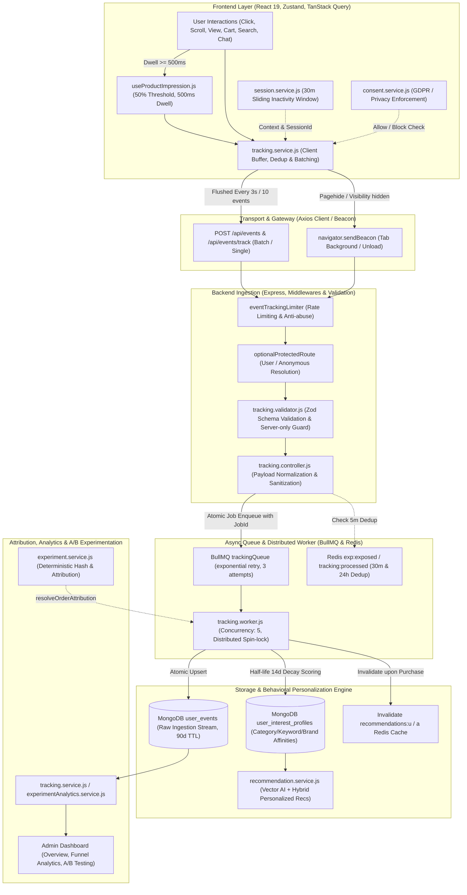

# KIẾN TRÚC HỆ THỐNG USER BEHAVIOR TRACKING (A TO Z)
## Dự án: REACT-WebFashion (404 Studio)

---

## 1. TỔNG QUAN KIẾN TRÚC TOÀN HỆ THỐNG

Hệ thống User Behavior Tracking của REACT-WebFashion được xây dựng theo kiến trúc hướng sự kiện (Event-Driven Architecture) với khả năng chống chịu tải cao, xử lý bất đồng bộ qua hàng đợi BullMQ, lưu trữ đa tầng và tích hợp mật thiết với Vector AI Recommendation Engine.

---

## 2. QUY TRÌNH TIẾP NHẬN & XỬ LÝ SỰ KIỆN CHI TIẾT

### Bước 1: Thu thập và Đệm sự kiện ở Client (Client Buffering & Batching)
- **Đệm sự kiện (Buffer)**: Thu thập sự kiện vào mảng `eventBuffer` trong bộ nhớ, tối đa 10 sự kiện (`BATCH_SIZE = 10`) hoặc xả sau mỗi 3.000ms (`FLUSH_INTERVAL_MS = 3000`).
- **Chống mất mát khi đóng tab**: Lắng nghe `pagehide`, `beforeunload`, và `visibilitychange` (state = `hidden`), tự động sử dụng `navigator.sendBeacon` để giải phóng buffer ngay lập tức.
- **Lọc tự động**: Loại bỏ mọi hành vi của tài khoản có role `admin` để không gây nhiễu dữ liệu analytics.

### Bước 2: Xác thực & Bảo mật ở Cổng nạp (Ingestion Validation & Security)
- **Server-only Guard**: Chặn tuyệt đối các sự kiện nhạy cảm (`purchase_completed`, `order_placed`, `order_cancelled`) nếu phát sinh từ client.
- **PII Sanitization**: Tự động nhận diện và loại bỏ email, số điện thoại trong các truy vấn tìm kiếm (`query`) trước khi lưu trữ.
- **Chống trùng lặp (Dedup)**: Kiểm tra khóa `tracking:view:{userId}:{productId}` hoặc `exp:exposed:*` trong Redis với TTL 5 đến 30 phút.

### Bước 3: Hàng đợi BullMQ & Khóa phân tán (Distributed Concurrency)
- **Hàng đợi bền bỉ**: Khởi tạo BullMQ với cấu hình `attempts: 3`, `backoff: exponential`, `delay: 1000ms`.
- **Exactly-Once Semantics**: Đặt `jobId = event_id`. Khi trùng lặp sự kiện được gửi lại, BullMQ tự động từ chối duplicate job.
- **Distributed Lock**: Sử dụng `lock:profile:{identity}` với TTL 6.000ms kèm spin-wait jitter để tránh race condition khi cập nhật điểm số sở thích người dùng.

### Bước 4: Suy giảm điểm theo thời gian (Half-Life Recency Decay)
- Điểm quan tâm của người dùng suy giảm theo hàm mũ với chu kỳ bán rã 14 ngày (`HALF_LIFE_DAYS = 14`):
  $$\text{DecayFactor} = 0.5^{\frac{\Delta t}{14}}$$
- Đảm bảo các sở thích cũ mờ nhạt dần theo thời gian và sở thích mới phản ánh tức thì vào thuật toán cá nhân hóa.
