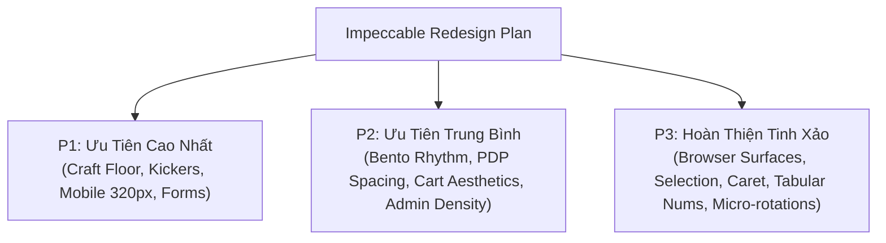

# KẾ HOẠCH TÁI THIẾT KẾ & NÂNG TẦM CHẤT LƯỢNG GIAO DIỆN (REDESIGN PLAN)

**Dự án:** `REACT-WebFashion`  
**Giai đoạn:** Phase 24 — Impeccable Full Website Review & Redesign  
**Thời gian lập:** 16/11/2026  
**Chiến lược cốt lõi:** Impeccable Craft Floor + Taste-Skill Anti-Slop + Hallmark Purpose-Built Templates  

---

## 1. PHÂN CẤP ƯU TIÊN HÀNH ĐỘNG (PRIORITIZATION MATRIX)

### 1.1. Nhóm P1 — Nhiệm vụ cốt lõi bắt buộc xử lý ngay
1. **Loại bỏ triệt để Kicker/Eyebrow thừa:**
   - Xóa bỏ các dòng chữ in hoa nhỏ phía trên tiêu đề tại Homepage, Lookbooks, Checkout, About, User Dashboard. Để tiêu đề Display tự dẫn dắt sức mạnh thị giác.
2. **Khắc phục hiển thị trên Mobile cực nhỏ (320px):**
   - Đảm bảo thanh Header, nút giỏ hàng, thẻ sản phẩm và form đăng nhập hiển thị hoàn hảo, không bị đè chữ, không cuộn ngang.
   - Vùng chạm (touch target) đạt tối thiểu $\ge 44\times 44\text{px}$.
3. **Chuẩn hóa trường nhập liệu và phản hồi biểu mẫu (Forms & Inputs):**
   - Chiều cao input chuẩn $48\text{px}$, nhãn rõ ràng, thông báo lỗi kèm hướng dẫn phục hồi cụ thể (chuẩn `impeccable clarify`).
4. **Tối ưu trải nghiệm đọc (Measure & Reading Proportions):**
   - Khống chế chiều rộng dòng chữ đọc tại các trang nội dung tĩnh `/about`, `/policy`, `/terms` ở mức $65–75\text{ch}$ (`max-w-[68ch]`), tránh việc dòng chữ quá dài gây mỏi mắt.

### 1.2. Nhóm P2 — Tái cấu trúc bố cục & Nhịp điệu trang
1. **Homepage:**
   - Làm mới cấu trúc Hero và Bento Grid: Tạo nhịp điệu bất đối xứng nghệ thuật, phối hợp mượt mà với Three.js Canvas sợi lụa.
2. **Product Detail Page (PDP):**
   - Áp dụng nguyên tắc Spacing: Khoảng trống trên tiêu đề sâu hơn khoảng trống dưới tiêu đề.
   - Bổ sung thanh mua dính đáy màn hình (Sticky Buy Dock) trên mobile với thao tác chọn nhanh size và thêm giỏ hàng trong 1 chạm.
3. **Cart & Checkout:**
   - Giảm tải nhận thức (Cognitive Load $\le 4$ lựa chọn cùng lúc).
   - Tối ưu hóa bảng tổng tiền và biểu tượng xác thực bảo mật thanh toán.
4. **Admin Portal:**
   - Cân bằng lại lưới 12 cột, phân bổ mật độ thông tin đồng đều trên màn hình lớn 1920px.

### 1.3. Nhóm P3 — Tinh chỉnh bề mặt trình duyệt & Hoàn thiện vi mô
1. **Browser Surfaces:**
   - Tùy biến `::selection` với màu nền Signal Orange mờ (`rgba(230, 81, 0, 0.2)`) và màu chữ tương phản.
   - Đặt `caret-color: var(--color-accent-signal)`.
   - Thiết lập `font-variant-numeric: tabular-nums` cho tất cả giá tiền và số liệu kỹ thuật.
2. **Accordion FAQ:**
   - Tăng cỡ chữ tiêu đề câu hỏi lên $16\text{px}$ và bổ sung chuyển động xoay chevron $180^\circ$ êm ái.

---

## 2. KẾ HOẠCH TRIỂN KHAI THEO TỪNG FILE NGUỒN

| File Cần Chỉnh Sửa | Nhiệm Vụ Cụ Thể | Tiêu Chuẩn Áp Dụng |
| :--- | :--- | :--- |
| `frontend/src/styles/tokens.css` | Khai báo các token Measure (`--measure-prose: 68ch`), Input height (`--input-h-md: 48px`), Click targets (`--touch-target-min: 44px`), Browser surfaces | Impeccable Design System Normalization |
| `frontend/src/styles/index.css` | Định nghĩa `::selection`, `caret-color`, `tabular-nums`, focus ring chuẩn mực, loại bỏ kicker classes rập khuôn | Impeccable Craft Floor & Browser Surfaces |
| `frontend/src/pages/store/Home.jsx` | Xóa bỏ kicker thừa, tái cấu trúc bento grid và hero typography theo phong cách tạp chí thời trang ấn tượng | Impeccable Refuse & Hallmark Template A |
| `frontend/src/components/shared/ProductCard.jsx` | Tối ưu hóa layout thẻ sản phẩm trên mobile 320px, kích cỡ nút wishlist/compare đạt chuẩn touch target | Impeccable Adapt & Component Review |
| `frontend/src/pages/store/ProductDetail.jsx` | Tinh chỉnh nhịp Spacing, chuẩn hóa bảng chọn size và sticky buy dock trên mobile | Impeccable Spacing & Cognitive Load |
| `frontend/src/pages/store/Cart.jsx` & `Checkout.jsx` | Tinh giản nhận thức, hoàn thiện bảng tóm tắt đơn hàng và form validation | Impeccable Operate & Clarify |
| `frontend/src/pages/store/StaticPages.jsx` | Áp dụng `max-w-[68ch]` cho văn bản bài viết, mục lục điều hướng tinh gọn | Impeccable Read & Typeset |
| `frontend/src/pages/customer/CustomerPages.jsx` | Thay viền trái dày bằng badge may đo cao cấp, tối ưu hóa dashboard cá nhân | Impeccable Refuse & Operate |

---

## 3. LỘ TRÌNH THỰC HIỆN LIÊN TỤC

1. Cập nhật Design Tokens & CSS toàn cục trong `tokens.css` và `index.css`.
2. Triển khai tài liệu `reports/impeccable/DESIGN_SYSTEM_CHANGES.md`.
3. Tinh chỉnh mã nguồn các trang (Home, ProductCard, PDP, Cart/Checkout, StaticPages, CustomerPages).
4. Kiểm thử biên dịch `npm run build` để đảm bảo 0 lỗi.
5. Chạy Playwright tự động chụp bộ ảnh `reports/impeccable/screenshots/after/` trên 5 viewports và 2 themes.
6. So sánh trực quan và lập báo cáo `VISUAL_COMPARISON.md`.
7. Kiểm thử hồi quy chức năng và ghi nhận `FUNCTIONAL_TEST_RESULTS.md`.
8. Đo lường hiệu năng và lập `PERFORMANCE_RESULTS.md`.
9. Quay video kiểm thử Master E2E `videos/FULL_WEBSITE_E2E_TEST.webm`.
10. Tổng hợp báo cáo cuối cùng `IMPECCABLE_FINAL_REPORT.md` và artifact `PHASE_24_FINAL_DELIVERY_REPORT.md`.
11. Commit và push lên `origin/redesign-v2`.
