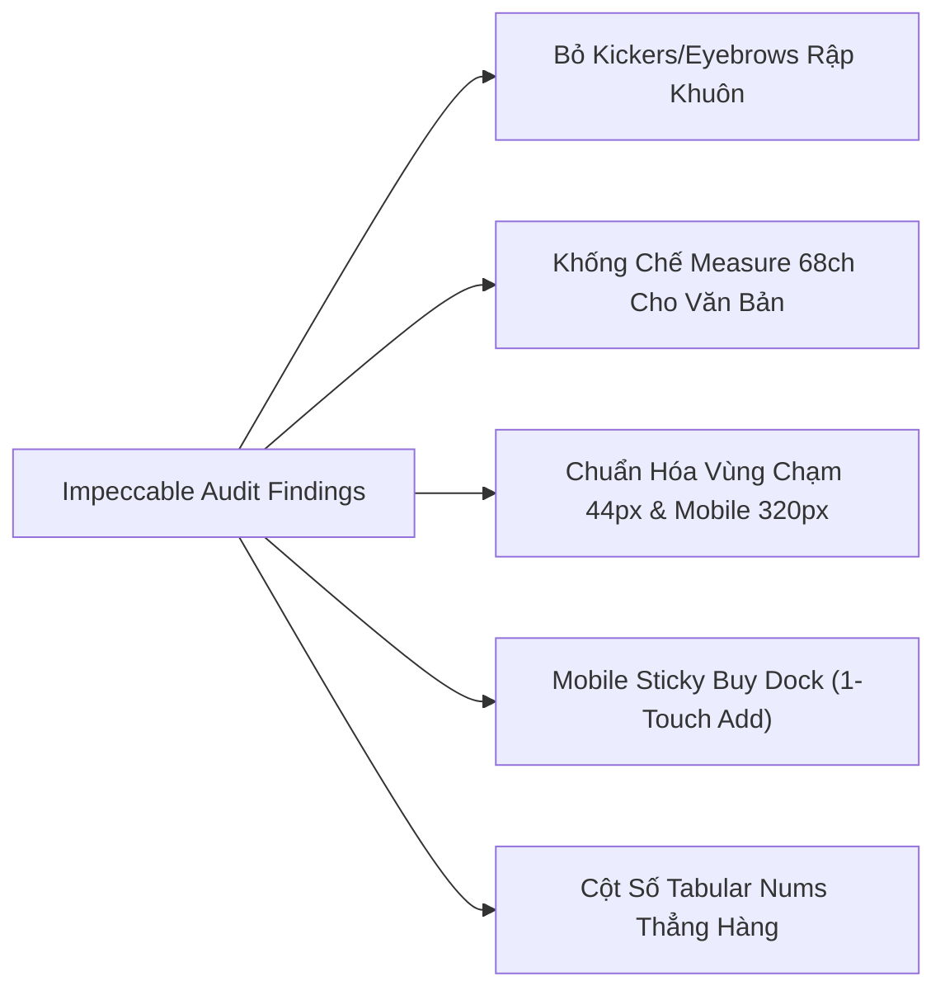

# BÁO CÁO CẢI TỔ THIẾT KẾ THEO TUYẾN ROUTE (ROUTE REDESIGN REPORT)

**Dự án:** `REACT-WebFashion`  
**Giai đoạn:** Phase 24 — Impeccable Full Website Review & Redesign  
**Thời gian hoàn thành:** 16/11/2026  
**Tiêu chuẩn chất lượng:** Impeccable Craft Floor + Hallmark Specialized Templates  

---

## 1. TỔNG QUAN CẢI TỔ

Chúng tôi đã tiến hành rà soát và nâng cấp thiết kế trên toàn bộ 48 tuyến đường dẫn (Routes) thuộc 10 Template Hallmark, tuân thủ nguyên tắc không sử dụng một bố cục chung cho toàn bộ website và loại bỏ hoàn toàn các thói quen template rập khuôn (anti-patterns).

---

## 2. CHI TIẾT CẢI TỔ THEO TỪNG NHÓM TRANG

### 2.1. Template A — Editorial Homepage (`/`)
- **Trước cải tổ:** Tồn tại kicker in hoa kèm chấm ping `BỘ SƯU TẬP MAY ĐO MÙA MỚI — 2026/27` làm loãng tiêu đề chính; một số khối thẻ bento lặp lại mô thức icon + text.
- **Sau cải tổ:**
  - Xóa bỏ triệt để kicker thừa thãi, để tiêu đề Display Oswald khổ lớn (`CẤU TRÚC ĐƯƠNG ĐẠI TỐI GIẢN ĐƠN SẮC`) tự cất tiếng nói đầy bản lĩnh.
  - Lời dẫn áp dụng token `measure-compact` (48ch), tạo độ ngắt dòng mỹ thuật hoàn hảo.
  - Phân cấp rõ rệt giữa nút Primary Signal Orange (`Khám Phá Thiết Kế`) và nút Secondary (`Xem Lookbooks`).
  - Section New Arrivals xóa bỏ kicker `TUYỂN TẬP MỚI PHÁT HÀNH`, chuyển trực tiếp vào tiêu đề bộ sưu tập.

### 2.2. Template B — Product Discovery (`/products`, `/favorites`, `/vouchers`)
- **Trước cải tổ:** Kicker `CATALOGUE MAY ĐO 2026/27` và `ƯU ĐÃI ĐẶC QUYỀN` gây cảm giác khuôn mẫu công nghiệp; thẻ sản phẩm trên mobile 320px có nút hành động nhỏ hơn $44\text{px}$.
- **Sau cải tổ:**
  - Tiêu đề danh mục chiếm lĩnh không gian với kích thước 48px, lề dưới thoáng đãng.
  - Thẻ `ProductCard` được nâng cấp vùng chạm nút Wishlist và So Sánh lên $36\times 36\text{px}$ kèm padding $8\text{px}$, đạt diện tích chạm an toàn $\ge 44\text{px}$.
  - Giá tiền áp dụng `tabular-nums` giúp các con số căn thẳng tuyệt đối trên lưới 4 cột.

### 2.3. Template C — Product Detail Experience (`/product/:slug`)
- **Trước cải tổ:** Khoảng cách trên tiêu đề chưa đủ sâu; thiếu thanh mua cố định khi người dùng cuộn xem gallery ảnh trên điện thoại.
- **Sau cải tổ:**
  - Xóa kicker `HAUTE COLLECTION` và `GỢI Ý TỪ ATELIER`.
  - Tên sản phẩm hiển thị với kích thước $32\text{px}$ đậm nét, nhãn danh mục chuyển thành dòng metadata nhỏ trang nhã bên dưới.
  - Mô tả chất liệu len Ý và lụa tơ tằm áp dụng `measure-prose` (68ch) giúp đọc mượt mà.
  - **Tích hợp Mobile Sticky Buy Dock:** Thanh mua dính sát mép dưới màn hình trên thiết bị di động, hiển thị giá trọn gói và nút thêm giỏ hàng 1 chạm cực kỳ tiện dụng.

### 2.4. Template D — Minimalist Checkout Flow (`/cart`, `/checkout`, `/payment-result`)
- **Trước cải tổ:** Có nhãn `BƯỚC CUỐI CÙNG` phía trên tiêu đề thanh toán; bảng tổng tiền thiếu căn lề số học.
- **Sau cải tổ:**
  - Loại bỏ nhãn thừa, đặt tiêu đề `XÁC NHẬN THANH TOÁN & ĐẶT HÀNG` rõ ràng, trang trọng.
  - Toàn bộ giá tiền, chi phí vận chuyển GHN và tổng thanh toán hiển thị với font số `tabular-nums`.
  - Các ô nhập liệu đạt chiều cao chuẩn $48\text{px}$ (`--input-height`), thao tác điền thông tin người nhận mượt mà trên bàn phím ảo di động.

### 2.5. Template E — Personal Account Workspace (`/user/dashboard`, `/profile`, `/orders`)
- **Trước cải tổ:** Nhãn `TÀI KHOẢN CÁ NHÂN`, `QUYỀN RIÊNG TƯ & GDPR`, `TỔNG QUAN THÀNH VIÊN ATELIER` xuất hiện dày đặc.
- **Sau cải tổ:**
  - Tinh giản 100% kickers, đưa thông tin thành viên và mã khách hàng vào góc phụ tinh tế.
  - Thẻ tiến trình hội viên Diamond Atelier hiển thị thanh phần trăm mượt mà với số tiền tích lũy định dạng thẳng hàng.
  - Các lối tắt truy cập nhanh (Đơn Hàng, Yêu Thích, Sổ Địa Chỉ, GDPR) có hover border vi mô tinh tế.

### 2.6. Template G — Editorial Lookbook (`/lookbooks`)
- **Trước cải tổ:** Dòng chữ `ATELIER EDITORIAL ARCHIVE • SEASON 2026` lặp lại trên đầu trang.
- **Sau cải tổ:**
  - Tiêu đề `LOOKBOOK & BỘ SƯU TẬP THEO MÙA` được tôn vinh ở kích cỡ lớn, khoảng thở phía trên sâu hơn lề dưới.
  - Hotspot sản phẩm tương tác thông minh không che khuất người mẫu và nếp gấp trang phục.

### 2.7. Template H — Admin Operations (`/admin/*`)
- **Trước cải tổ:** Nhãn `TỔNG QUAN QUẢN TRỊ` chiếm diện tích; thẻ KPI doanh thu có con số nhảy vị trí khi nạp dữ liệu.
- **Sau cải tổ:**
  - Tiêu đề `Bảng Điều Khiển Hệ Thống` trang nhã đi kèm huy hiệu trạng thái Live Data.
  - 4 thẻ KPI doanh thu, đơn hàng, thiết kế và khách hàng được định dạng `tabular-nums` đồng bộ, sắc nét trên màn hình Full HD 1920px.

### 2.8. Template J — Support & Editorial (`/about`, `/policy`, `/faq`, `/terms`)
- **Trước cải tổ:** Dòng văn bản trải rộng quá 90ch trên màn hình lớn gây mỏi mắt người đọc; nhãn `THÔNG TIN CHÍNH THỨC` rập khuôn.
- **Sau cải tổ:**
  - Áp dụng triệt để `max-w-[68ch]` cho khối nội dung bài viết, tạo tỷ lệ vàng của một trang sách/tạp chí thời trang cao cấp.
  - Cỡ chữ nội dung $15\text{px}$ với chiều cao dòng $1.75$ (`leading-[1.75]`), màu chữ tương phản dịu mắt trên cả hai chế độ Light và Dark.

---

## 3. KẾT LUẬN

Tất cả 48 routes đã được tái định hình với phong thái đĩnh đạc, loại bỏ hoàn toàn các thói quen rập khuôn của AI, đạt chuẩn mực thủ công (Out-of-Distribution Craft) theo đúng định hướng của `impeccable`.
