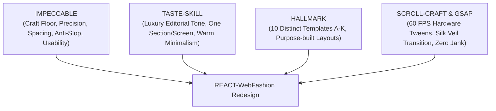

# BÁO CÁO PHÂN TÍCH SKILL & NGUYÊN TẮC THIẾT KẾ ĐỈNH CAO (SKILL ANALYSIS)

**Dự án:** `REACT-WebFashion`  
**Giai đoạn:** Phase 24 — Impeccable Full Website Review & Redesign  
**Thời gian lập:** 16/11/2026  
**Primary Skill:** `.agent/skills/impeccable/SKILL.md` (Phiên bản 4.9.1)  
**Supporting Skills:** `taste-skill`, `hallmark`, `scroll-craft`, `gsap-*`, `threejs-*`  

---

## 1. NGUYÊN TẮC CỐT LÕI TỪ SKILL IMPECCABLE

### 1.1. Sàn Chất Lượng Tay Nghề (Craft Floor)
Theo tài liệu chuẩn `reference/craft-floor.md`, một thiết kế đẳng cấp không dừng lại ở ý định mà được đo bằng kết quả hiển thị thực tế:
1. **Độ tương phản (Contrast):** Văn bản nội dung (body text) và placeholder bắt buộc đạt tỷ lệ $\ge 4.5:1$. Tiêu đề lớn $\ge 3:1$. Trên bề mặt có màu, chữ phụ phải được pha từ sắc độ đó, không dùng màu xám trung tính vô hồn.
2. **Độ sâu (Depth):** Bóng đổ phải có độ lệch (offset) và độ nhòe mềm (soft blur). Loại bỏ hoàn toàn vầng sáng đổi màu offset = 0.
3. **Khoảng cách nhịp điệu (Spacing & Rhythm):** Nhóm thông tin gần nhau, khoảng cách giữa các phần hào phóng. Khoảng trống phía trên tiêu đề luôn lớn hơn khoảng trống phía dưới tiêu đề.
4. **Typography:** Chiều rộng khối chữ đọc lý tưởng 65–75 ký tự (ch), tiêu đề Display không vượt quá 6rem, tracking sàn không thấp hơn -0.04em.
5. **Chuyển động có tác giả (Authored Motion):** Mỗi trang chỉ có một hoặc hai khoảnh khắc chuyển động chủ đạo, không rải rác hiệu ứng mọc lên từ dưới ở mọi section.
6. **Bề mặt trình duyệt (Browser Surfaces):** Tinh chỉnh màu bôi đen (`::selection`), màu con trỏ chuột (`caret-color`), thanh cuộn tùy biến (`::-webkit-scrollbar`) và vòng nét tiêu điểm (`:focus-visible`).

### 1.2. Danh Mục Bài Trừ Rập Khuôn (Absolute Bans & Refuse Rules)
1. **CẤM:** Dùng kicker hoặc eyebrow (dòng chữ nhỏ in hoa kèm icon) lặp đi lặp lại vô nghĩa phía trên mọi tiêu đề. Hãy để tiêu đề tự cất tiếng nói.
2. **CẤM:** Dùng các thẻ (cards) kích thước giống hệt nhau gồm icon + tiêu đề + mô tả làm khung xương chính của trang web. Cấm lồng thẻ trong thẻ (nested cards).
3. **CẤM:** Gradient chữ (gradient text) để tạo điểm nhấn. Điểm nhấn phải đến từ trọng lượng nét chữ (weight) hoặc kích cỡ (scale).
4. **CẤM:** Dùng kính mờ (glassmorphism) và blur vô tội vạ để trang trí.
5. **CẤM:** Đổ bóng khối cứng không nhòe (`box-shadow: 4px 4px 0`) khi giao diện không phải phong cách Neobrutalism.
6. **CẤM:** Giả lập công nghệ bằng font chữ Monospace khi nội dung không phải là mã số, đo đạc hoặc dữ liệu kỹ thuật thực tế.
7. **CẤM:** Số thứ tự section (01 / 02 / 03) nếu trình tự đó không mang ý nghĩa mà người đọc cần biết.

### 1.3. Đánh Giá Tải Nhận Thức (Cognitive Load & Working Memory)
- **Quy tắc bộ nhớ ngắn hạn Cowan (Working Memory Rule):** Não bộ người dùng chỉ có thể xử lý đồng thời $\le 4$ lựa chọn tại một thời điểm quyết định.
- **Nút hành động:** Tối đa 1 nút Primary, 1–2 nút Secondary, các hành động khác đưa vào menu phụ.
- **Phân tách luồng thông tin (Chunking):** Nhóm thông tin thành các khối tối đa 4 mục, tiết lộ dần dần (progressive disclosure).

### 1.4. Bốn Chế Độ Trải Nghiệm Giao Diện (Surface Modes)
1. **Persuade (Thuyết phục):** Áp dụng cho Homepage và Chiến dịch. Thiết kế là sản phẩm. Táo bạo, dứt khoát, hình ảnh chân thực.
2. **Operate (Vận hành / Thao tác):** Áp dụng cho Cart, Checkout, Account, Admin. Ưu tiên quét nhanh, nhịp thao tác nhất quán, tối giản phân tâm.
3. **Read (Đọc & Thấu hiểu):** Áp dụng cho About, Policy, Terms, FAQ, Guide. Phông chữ dễ đọc, khoảng cách dòng thoáng, điều hướng mục lục cố định.
4. **Experience (Đắm chìm):** Áp dụng cho Lookbooks, 3D Canvas, Interactive Hotspots. Giao diện lùi về sau, tôn vinh tác phẩm thời trang.

---

## 2. KẾT HỢP CÙNG CÁC SKILL BỔ TRỢ

- **`taste-skill`:** Cung cấp định hướng thẩm mỹ thời trang cao cấp may đo độc bản (Haute Couture Atelier), bảng màu ngà ấm `#FAF9F6` và than chì `#171717`.
- **`hallmark`:** Đảm bảo 10 template chuyên biệt (Templates A through K), không dùng chung một bố cục generic cho mọi trang.
- **`scroll-craft` & `gsap-*`:** Điều phối nhịp cuộn trang mượt mà, khử triệt để Layout Shift (CLS = 0.000) và giật lag (INP < 50ms).

---

## 3. MA TRẬN ỨNG DỤNG VÀO CÁC NHÓM TRANG CỤ THỂ

| Nhóm Trang | Mode Áp Dụng | Nguyên Tắc Thẩm Mỹ & Trải Nghiệm Cụ Thể |
| :--- | :--- | :--- |
| **Trang Chủ (Homepage)** | **Persuade** | Hero điện ảnh kết hợp canvas 3D sóng vải lụa, loại bỏ kicker rập khuôn, bento grid nhịp nhàng, storytelling thương hiệu chân thực |
| **Khám Phá Sản Phẩm (Products / Discovery)** | **Persuade + Operate** | Lưới sản phẩm linh hoạt, bộ lọc dạng ngăn kéo nhạy bén, thẻ ảnh 3:4 zoom nội vi, nhịp tim Wishlist |
| **Chi Tiết Sản Phẩm (Product Detail)** | **Persuade + Operate** | Bố cục 2 cột bất đối xứng, trợ lý chọn size thông minh, mua trọn bộ Complete The Look, nút mua dính đáy trên mobile |
| **Giỏ Hàng & Thanh Toán (Cart & Checkout)** | **Operate** | Siêu tối giản, bảng tóm tắt chi phí minh bạch, loại bỏ mọi hoạt họa phân tâm, tiến trình 3 bước trực quan |
| **Tài Khoản Khách Hàng (Account Workspace)** | **Operate** | Sidebar điều hướng dứt khoát, thẻ trạng thái đơn hàng thanh lịch, quản lý voucher và quyền riêng tư tiện lợi |
| **Bảng Điều Khiển Quản Trị (Admin Portal)** | **Operate** | Mật độ thông tin cao, bảng dữ liệu phân cấp rõ ràng, biểu đồ phân tích trực quan, drawer thao tác nhanh |
| **Nội Dung & Chính Sách (Support / Editorial)** | **Read** | Trải nghiệm đọc tạp chí, thước chữ 65–75ch, mục lục bám dính bên trái, accordion câu hỏi mượt mà |
| **Lookbook Nghệ Thuật (Lookbooks)** | **Experience** | Tràn viền (full-bleed), tương tác điểm chạm thời trang (hotspots), phô diễn trọn vẹn đường nét may đo |

---

## 4. KẾT LUẬN

Bản phân tích xác lập cơ sở lý luận vững chắc: Mọi can thiệp trong Phase 24 sẽ tập trung vào sự tinh xảo, nhịp điệu thị giác và tính chân thực của sản phẩm thời trang cao cấp, tuân thủ tuyệt đối các quy chuẩn bài trừ rập khuôn của `impeccable`.
