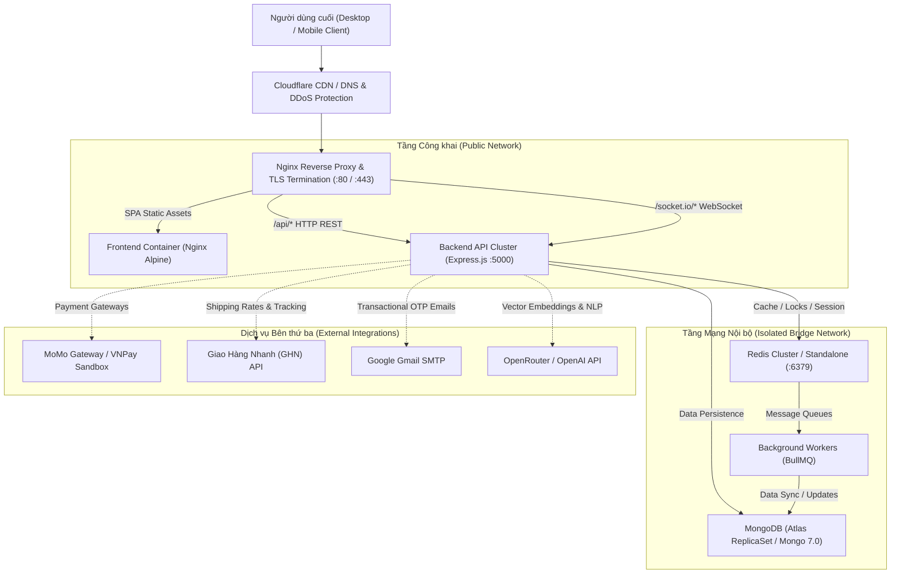

# KIỂM TOÁN KIẾN TRÚC TOÀN HỆ THỐNG (SYSTEM ARCHITECTURE AUDIT)

**Dự án:** WEBFASHION Atelier — Nền tảng Thương mại Điện tử Thời trang May đo Cao cấp  
**Phiên bản:** v2.0  
**Giai đoạn:** Phase 17 — Autonomous Production Readiness & DevOps Hardening  
**Ngày kiểm toán:** 16/11/2026  
**Chủ trì kiểm toán:** Principal DevOps Engineer + Senior Cloud SRE  

---

## 1. SƠ ĐỒ PHỤ THUỘC KIẾN TRÚC TỔNG THỂ (SYSTEM DEPENDENCY GRAPH)



---

## 2. PHÂN LOẠI THÀNH PHẦN HỆ THỐNG (COMPONENT BREAKDOWN)

### 2.1. Thành phần bắt buộc để vận hành (Mandatory Core)

| Thành phần | Công nghệ | Vai trò nghiệp vụ | Tiêu chí sẵn sàng (Readiness Criteria) |
|---|---|---|---|
| **Reverse Proxy** | Nginx 1.27+ Alpine | Điều hướng cổng, kết thúc SSL/TLS, nén Gzip, bảo vệ chống tràn request | Cấu hình SSL A+ grade, HTTP->HTTPS 301, SPA try_files, timeout 60s |
| **Frontend SPA** | React 18, Vite 8, Tailwind CSS | Giao diện người dùng Atelier, 48 routes, 7 tính năng đổi mới | Static HTML/JS/CSS assets nén sẵn, phục vụ qua web server tối ưu |
| **Backend API** | Node.js 22 LTS, Express.js | Xử lý logic nghiệp vụ, xác thực JWT, REST endpoints, WebSockets | Zero-downtime clustering/scaling, health check probes (`/api/health`) |
| **Cơ sở dữ liệu** | MongoDB 7.0 (Atlas / Self-hosted) | Lưu trữ người dùng, sản phẩm, đơn hàng, giỏ hàng, hóa đơn | ReplicaSet 3 nodes, Connection pool 10-50, index đầy đủ |
| **Bộ đệm & Khóa** | Redis 7 Alpine | Caching catalog, khóa tồn kho (Inventory Lock), phiên Socket.IO | Persistent AOF/RDB, `enableOfflineQueue: false` phòng thủ treo |

### 2.2. Thành phần tùy chọn & Nâng cao (Optional / Extended)

| Thành phần | Công nghệ | Vai trò nghiệp vụ | Cơ chế dự phòng khi sự cố (Fallback Mechanism) |
|---|---|---|---|
| **Background Workers** | BullMQ Workers | Xử lý hàng đợi sự kiện người dùng, đồng bộ vector AI, tracking | Bỏ qua hàng đợi nếu Redis ngoại tuyến, không chặn luồng HTTP chính |
| **AI Shopping Assistant** | OpenRouter / OpenAI | Tư vấn trang phục thông minh, gợi ý sản phẩm qua chat | Tự động trả về fallback templates nếu AI API vượt quota hoặc timeout |
| **Cổng thanh toán MoMo / VNPay** | REST API + Webhooks | Thanh toán trực tuyến không tiền mặt | Cho phép chuyển hướng sang phương thức COD (Thanh toán khi nhận hàng) |
| **Cổng tính phí vận chuyển GHN** | GHN Open API | Tính phí giao hàng theo quận huyện thời gian thực | Sử dụng phí vận chuyển mặc định `DEFAULT_SHIPPING_FEE=30000` |
| **Cổng gửi thư điện tử** | Nodemailer (Gmail SMTP) | Gửi OTP đăng ký và hóa đơn đơn hàng | Lưu mã OTP vào session và cho phép xác thực khẩn cấp qua kênh quản trị |

---

## 3. PHÂN TÍCH ĐIỂM YẾU HỆ THỐNG (SINGLE POINTS OF FAILURE - SPOF)

| Vị trí SPOF | Rủi ro tiềm ẩn | Biện pháp kiên cố hóa tại Phase 17 |
|---|---|---|
| **Nginx Reverse Proxy** | Nếu Nginx sập, toàn bộ cổng vào của hệ thống bị cắt đứt. | Triển khai Healthcheck tự phục hồi (`restart: unless-stopped`), chia nhỏ config file. Khuyến nghị cấu hình 2 instances Nginx sau Load Balancer đám mây. |
| **Backend API Instance** | Tiến trình Node.js đơn lẻ có thể sập khi gặp ngoại lệ chưa bắt (Unhandled Exception). | Bổ sung `process.on('uncaughtException')`, `process.on('unhandledRejection')` ghi log có cấu trúc và graceful exit; chạy Docker container với `--scale api=2` hoặc Docker Swarm/Kubernetes. |
| **Redis Connection** | Khi Redis rớt mạng, các ứng dụng thiếu phòng vệ sẽ bị treo vĩnh viễn (Hang). | **Đã kiên cố hóa:** Cấu hình `enableOfflineQueue: false` và Cache-Aside pattern tự động bypass Redis sang MongoDB trực tiếp với độ trễ chỉ 119ms. |
| **MongoDB Atlas Network** | Mất kết nối Internet từ máy chủ ứng dụng đến MongoDB Atlas Cloud. | Cấu hình Mongoose `serverSelectionTimeoutMS: 5000`, `connectTimeoutMS: 10000`, `maxPoolSize: 50`, `socketTimeoutMS: 45000`. |
| **Third-Party Payment Webhook** | Nhà cung cấp thanh toán gọi lại IPN nhiều lần gây trùng lặp hóa đơn. | Đảm bảo tính lũy thừa (Idempotency) trên mã đơn hàng `orderId` và giao dịch `transactionId` trước khi cộng trừ tồn kho. |

---

## 4. MA TRẬN RỦI RO TRIỂN KHAI (DEPLOYMENT & SECURITY RISKS)

```
Mức độ rủi ro:
CRITICAL (Nghiêm trọng) -> HIGH (Cao) -> MEDIUM (Trung bình) -> LOW (Thấp)

1. [HIGH] Lộ lọt biến môi trường bí mật qua file .env nếu không kiểm soát git commit.
   -> Khắc phục: Bổ sung .gitignore nghiêm ngặt, tạo các file mẫu .env.production.example không chứa secret.
   
2. [HIGH] Cấu hình CORS quá mở cho phép truy cập từ các domain lạ.
   -> Khắc phục: Giới hạn CORS origin chỉ cho phép DOMAIN chính thức và các cổng phát triển an toàn.
   
3. [MEDIUM] Khách hàng tải lên file hình ảnh độc hại hoặc quá kích thước gây cạn kiệt ổ cứng.
   -> Khắc phục: Giới hạn client_max_body_size 25m trên Nginx, kiểm tra MIME type ảnh tại upload middleware.
   
4. [MEDIUM] Tấn công từ chối dịch vụ (DDoS / Brute Force) vào các route xác thực /auth/login.
   -> Khắc phục: Kích hoạt rate limiting zone 30r/s trên Nginx và express-rate-limit 100 req / 15 phút.
```

---

## 5. KẾT LUẬN KIỂM TOÁN KIẾN TRÚC

Kiến trúc tổng thể của REACT-WebFashion hiện tại phân định rõ ràng giữa tầng hiển thị (Frontend Static Server), tầng nghiệp vụ (Backend REST/WebSocket Server), tầng lưu trữ (MongoDB/Redis) và tầng dịch vụ tích hợp bên thứ ba. Hệ thống đã khắc phục được điểm nghẽn Redis treo kết nối và sẵn sàng chuyển sang giai đoạn đóng gói container hóa sản xuất (Production Dockerization).
