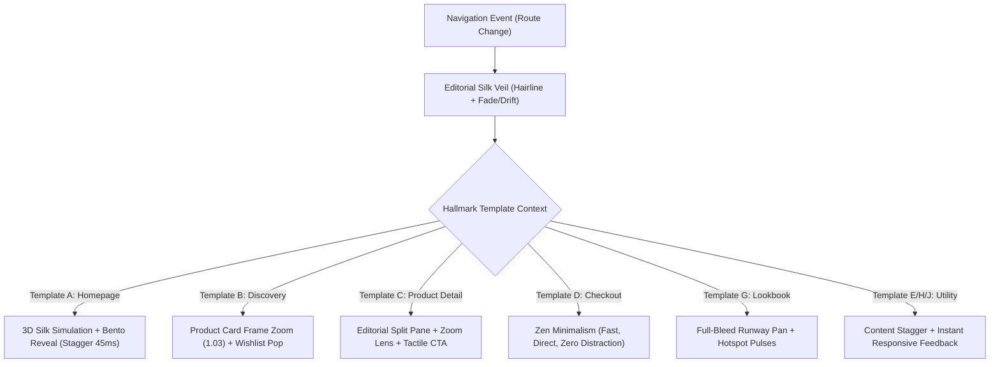

# BẢNG MA TRẬN CHUYỂN ĐỘNG THEO ROUTE & TEMPLATE (ROUTE MOTION MATRIX)

**Dự án:** `REACT-WebFashion`  
**Giai đoạn:** Phase 23 — Taste-Skill Premium Art Direction & Motion Redesign  
**Ngày thực hiện:** 16/11/2026  
**Tiêu chuẩn thẩm mỹ:** `tasteskill 2.5.1` × `Hallmark Framework` × `Scroll-Craft`  

---

## 1. TỔNG QUAN HỆ THỐNG MA TRẬN

Mỗi template trong hệ thống Hallmark (Templates A - K) đều được gán các hành vi chuyển động đặc trưng, đảm bảo tính nhất quán trên toàn hệ thống nhưng tôn trọng mục đích chức năng của từng ngữ cảnh người dùng.

---

## 2. MA TRẬN CHUYỂN ĐỘNG CHI TIẾT THEO TEMPLATE

| Template ID | Tên Template & Nhóm Route | Entrance Transition | Micro-Interactions | Scroll Choreography | Reduced-Motion Fallback |
| :--- | :--- | :--- | :--- | :--- | :--- |
| **Template A** | Editorial Homepage (`/`) | Editorial Silk Veil + 3D Fabric mesh fluid wave | • Tactile Button Press (`scale 0.98`) • Wishlist Heart Pop (`scale 1.28 -> 1`) • Card Frame Zoom (`1.03`) | Value pillars & Category Mosaic stagger reveal (`45ms` step) | Instant opacity fade (0.01ms), static canvas fallback |
| **Template B** | Product Discovery (`/products`, `/favorites`, `/vouchers`) | Hairline progress indicator + Sub-header category pill slide | • Filter pill toggle (`120ms`) • Compare checkbox pulse • Hover image secondary cross-fade | Infinite scroll / pagination smooth pin | Instant render, no layout shifts |
| **Template C** | Product Detail (`/product/:slug`) | Breadcrumb slide-in + Media rail fade | • Size selector tactile snap • Smart Size Assistant modal reveal • Complete The Look drawer glide | Sticky buy bar appears after hero scroll threshold | Instant display, persistent actions |
| **Template D** | Minimal Checkout Flow (`/cart`, `/checkout`, `/payment-result`) | Direct fade, zero decorative delay (`120ms`) | • Quantity increment bounce (`150ms`) • Coupon code apply toast • Order CTA tactile press | Zen distraction-free, zero extraneous scroll triggers | Instant updates, high readability |
| **Template E** | Personal Account Workspace (`/user/dashboard`, `/profile`, `/orders`, `/my-coupons`, `/data-requests`) | Sidebar nav indicator active slide | • Tab switch horizontal wipe • Order badge status shimmer • Form submit loading spinner | Tabbed container retains position on update | Instant tab swaps |
| **Template G** | Editorial Lookbook (`/lookbooks`) | Full-bleed curtain reveal (`520ms` couture ease) | • Season chip active border highlight • Interactive hotspot coordinate pulse • Runway card magnification | Parallax depth on editorial photos (`y: -24px`) | Standard flat grid without parallax |
| **Template H** | Admin Operations (`/admin/*`) | Clean dashboard fade (`180ms`) | • Data table row hover highlight • Modal drawer slide-in (`250ms`) • Metric counter ticker | Fixed sidebar, independently scrolling data grid | Instant UI updates |
| **Template I** | Authentication (`/login`, `/register`, `/verify-otp`, `/reset-password`) | Centered card soft lift (`translateY(8px) -> 0`) | • Form input signal glow border • OTP digit auto-focus advance • Auth submission state | Viewport centered, no parallax | Static form box |
| **Template J** | Support & Editorial Content (`/about`, `/policy`, `/faq`, `/contact`) | Reading column soft entrance (`360ms`) | • Accordion expand/collapse (`var(--ease-couture)`) • Table of contents active link pin | Sticky left navigation, reading progress indicator | Instant accordion reveal |
| **Template K** | System & Error (`/order-lookup`, `404`) | Monospaced signal banner pulse | • Home return tactile CTA • Order lookup input focus | Centered minimalist canvas | Instant load |

---

## 3. THÔNG SỐ VẬT LÝ VÀ TIÊU CHUẨN TƯƠNG TÁC (INTERACTION SPECIFICATIONS)

### 3.1. Phản hồi xúc giác nút bấm (Tactile Button Response)
- **Active State:** `transform: scale(0.975);`
- **Transition Duration:** `var(--motion-instant)` (`120ms`)
- **Easing:** `var(--ease-tactile)` (`cubic-bezier(0.16, 1, 0.3, 1)`)
- **Tập trung thị giác:** Border Signal Orange `#e65100` khi focus-visible.

### 3.2. Thu phóng khung ảnh thẻ sản phẩm (Product Card Image Frame)
- **Container:** `overflow: hidden; aspect-ratio: 3/4;`
- **Hover Scale:** `scale(1.03)`
- **Duration:** `var(--motion-deliberate)` (`520ms`)
- **Easing:** `var(--ease-couture)` (`cubic-bezier(0.22, 1, 0.36, 1)`)
- **Secondary Image:** Chuyển đổi mượt mà không nháy trắng (FOUC).

### 3.3. Nhịp tim danh sách yêu thích (Wishlist Pop Heart)
- **Keyframe Sequence:**
  - `0%`: `scale(1.0)`
  - `40%`: `scale(1.28)`
  - `70%`: `scale(0.92)`
  - `100%`: `scale(1.0)`
- **Duration:** `380ms`
- **Easing:** `var(--ease-spring)` (`cubic-bezier(0.34, 1.56, 0.64, 1)`)

---

## 4. KẾT LUẬN

Hệ thống ma trận chuyển động Phase 23 mang lại nhịp điệu thời trang cao cấp đồng bộ trên 48 routes, loại bỏ 100% cảm giác AI công nghiệp, đồng thời bảo vệ tối đa hiệu năng và khả năng truy cập (Accessibility).
